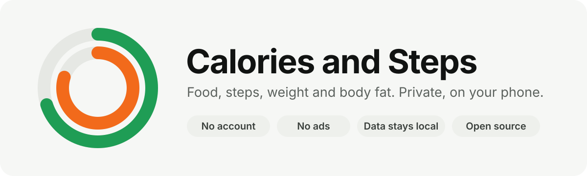
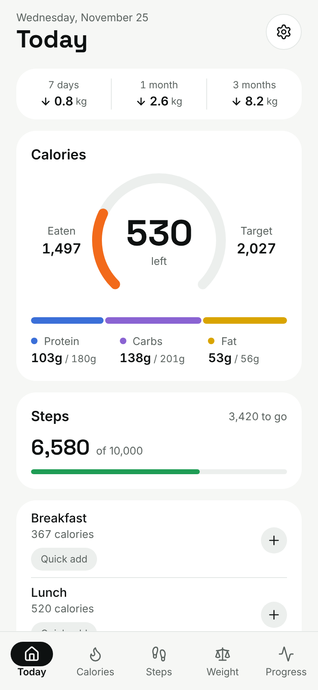
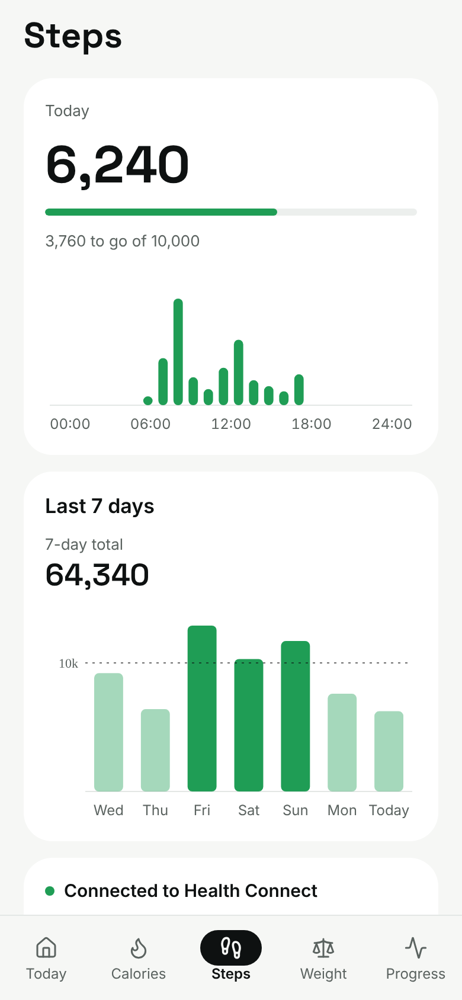
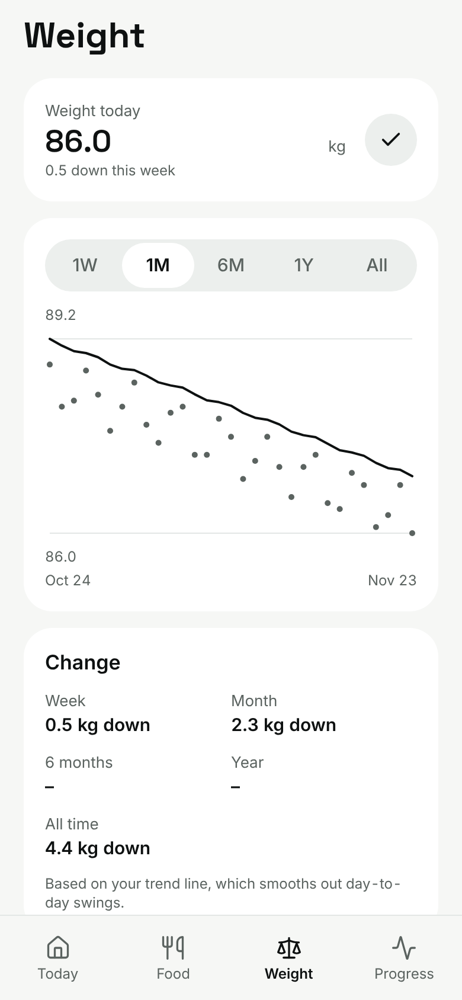
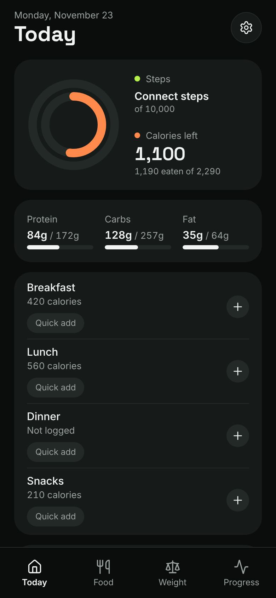
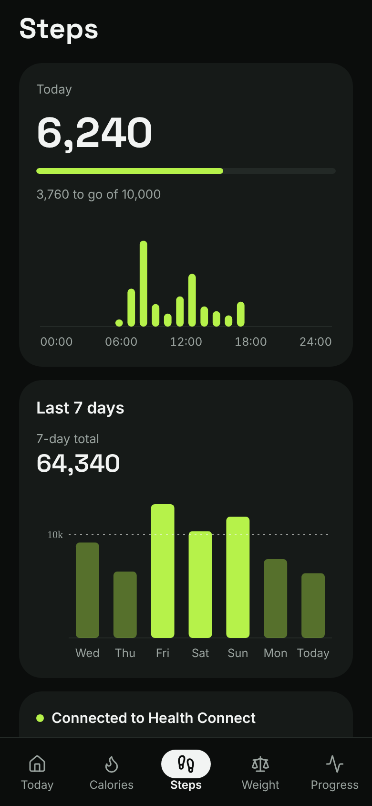

<p align="center">
  
</p>

<p align="center">
  <a href="https://github.com/warwickbuilds/calories-and-steps/releases/latest"></a>
  <a href="https://github.com/warwickbuilds/calories-and-steps/releases"></a>
  <a href="LICENSE"></a>
</p>

<p align="center">
  <a href="https://github.com/warwickbuilds/calories-and-steps/actions/workflows/ci.yml"></a>
  <a href="https://github.com/warwickbuilds/calories-and-steps/actions/workflows/android-release.yml"></a>
  
  
  
  
  
  
  
  <a href="CONTRIBUTING.md"></a>
  <a href="https://github.com/warwickbuilds/calories-and-steps/commits/main"></a>
</p>

<p align="center">
  <a href="https://github.com/warwickbuilds/calories-and-steps/releases/latest"><b>Download the latest APK</b></a> ·
  <a href="#install">Install guide</a> ·
  <a href="#what-it-does">Features</a> ·
  <a href="#your-data-and-privacy">Privacy</a> ·
  <a href="#for-developers">For developers</a> ·
  <a href="CONTRIBUTING.md">Contributing</a>
</p>

A simple, private Android app for tracking what you eat, how much you move and how your body changes. No account, no ads, no cloud: everything stays on your phone. Free and open source under the [MIT License](LICENSE).

## Contents

- [Highlights](#highlights)
- [Screenshots](#screenshots)
- [What it does](#what-it-does)
- [Install](#install)
- [Getting started](#getting-started)
- [Your data and privacy](#your-data-and-privacy)
- [For developers](#for-developers): [tech stack](#tech-stack), [status](#status), [features in detail](#features), [changelog](#versions-and-changelog), [architecture](#architecture), [services](#services), [releases](#releases), [running it](#running-it), [maintenance](#maintenance), [future enhancements](#future-enhancements)
- [Contributing](#contributing), [security](#security), [license](#license) and [acknowledgements](#acknowledgements)

## Highlights

| | |
| --- | --- |
| 📸 **Snap a meal** | Photograph a plate, say what's in it, and AI estimates every part with calories and macros. |
| 🔎 **Scan a barcode** | Look products up in Open Food Facts, or let AI read the nutrition label. |
| 👟 **Steps, automatically** | Read from Health Connect, with today by the hour and the last 7 days against your target. |
| ⚖️ **Weight that makes sense** | A smoothed trend, change over any period, 5 kg milestones and a projected goal date. |
| 📏 **Body fat (Navy method)** | Tape-measure check-ins, BMI alongside, and lined-up progress photos to compare. |
| 🔒 **Private by design** | No account, no tracking, no cloud. Your AI key, your data, your phone. Backups are a file you keep. |

## Screenshots

<table>
  <tr>
    <td align="center"><br /><sub><b>Today</b>: rings, macros and meals</sub></td>
    <td align="center"><br /><sub><b>Steps</b>: by the hour and the week</sub></td>
    <td align="center"><br /><sub><b>Weight</b>: trend, change and goal</sub></td>
  </tr>
  <tr>
    <td align="center"><br /><sub><b>Progress</b>: body fat and photos</sub></td>
    <td align="center"><br /><sub><b>Dark mode</b>: Today</sub></td>
    <td align="center"><br /><sub><b>Dark mode</b>: Steps</sub></td>
  </tr>
</table>

## What it does

- **Calories and macros.** A daily calorie target worked out from your body and activity, with a goal of hard cut, steady cut, maintain or bulk. Protein, carbs and fat are shown against their own targets.
- **Photograph a meal.** Take a photo (or pick one), say what's in it out loud or type it, and AI estimates each part of the meal with grams, calories and macros. Check and fix the list, then add it. Works from a description alone too ("two eggs on toast"). Uses your own Google AI key; speech is turned into text on your phone.
- **Meals.** Log breakfast, lunch, dinner and snacks. Search the foods you've had before and add one in a tap, change the servings or the amount (grams, or ml for drinks), quick add calories in seconds, or copy a meal from yesterday. Tap anything you logged to fix it or move it to another meal.
- **Barcodes and labels.** Scan a barcode to look the product up in Open Food Facts, pick a serving or type the amount, and add it. Drinks are measured in ml (worked out from the product, and switchable with one tap). If the product isn't there, photograph the nutrition label and AI reads it (using your own Google AI key). Every number can be fixed before adding, and scanned products are remembered on your phone.
- **Food history.** Step back through earlier days, add or fix food on any of them, and see your 7-day calorie average.
- **Weight.** A quick weigh-in on the home screen and charts from a week to all time. Each period shows how much you've lost in it as a big number. The chart joins your actual weigh-ins, with a faint dashed trend line that carries on to your goal, and coloured markers for every 5 kg lost.
- **Bring your weight history with you.** Screenshot the weight list in your old app (Lose It!, MyFitnessPal, a smart-scale app or anything that shows dates and weights), pick the screenshots, and AI reads every entry. You check and fix the list before anything is saved, and duplicates are skipped. Offered when you first set up the app, and any time from the Weight tab. Uses your own Google AI (Gemini) key.
- **Body fat.** Body fat (Navy method) check-ins from a tape measure, with lean and fat mass, plain BMI alongside, and front, side and back photos you can line up and compare side by side.
- **Steps.** Your steps come from Health Connect (Android's health app, which gathers them from your phone, watch or fitness apps). Today's ring fills towards your daily target (5,000 to 25,000), and the Steps tab shows today hour by hour, the last 7 days as bars against your target, and your 7-day total.
- **Light and dark.** Follows your phone, or pick one.
- **Updates.** The app tells you when a new version is out.
- **Backup and restore.** Save everything (meals, weights, check-ins, photos and settings) to one file on Google Drive, by email or in a folder on the phone, and restore it after reinstalling or on a new phone. Today reminds you every two weeks.

**Coming next:** more step history.

## Install

1. On the phone, open the [latest release](https://github.com/warwickbuilds/calories-and-steps/releases/latest) and download `calories-and-steps-<version>-arm64.apk` (about 30 MB). It fits almost every phone from the last several years. If Android says it can't install it (older 32-bit phones), download `calories-and-steps-<version>-universal.apk` instead, which works on every phone but is twice the size (about 60 MB). Releases before 0.16.0 have a single `calories-and-steps-<version>.apk` of about 143 MB.
2. Open the downloaded file. Android asks whether your browser (or Files app) may install unknown apps. Tap **Settings**, turn on **Allow from this source**, then go back and tap **Install**. You only need to do this once for that browser or app.
3. **Play Protect** may say the app is unrecognised or "unsafe" because it isn't from the Play Store. Tap **More details → Install anyway**. If it offers to scan the app, that's fine too.
4. Open the app and set up your profile.

**Updating**: when Today shows "Version x is available", tap **Download** and open the file. The app picks the right APK for your phone. It installs over the old version and keeps your data. Every release is signed with the same key, so this always works. If Android ever says the app "conflicts with an existing package", the APK was signed with a different key; don't uninstall to get around it, because that deletes your data.

## Getting started

1. Pick metric or imperial.
2. Enter your sex, age and height, then your current weight and an optional goal weight.
3. Choose how active you are and your goal (hard cut, steady cut, maintain or bulk). You'll see your daily calorie target and macros straight away.
4. Set a daily step target, and optionally connect Health Connect so the app can read your steps (or do it later from Today).
5. Optionally paste a Google AI (Gemini) key and tap **Save and test**. It's needed for AI features such as importing weight history. [Get a key here](https://aistudio.google.com/apikey).
6. Optionally import your weight history from another app's screenshots, or skip and do it later from the Weight tab.

Reinstalling or on a new phone? Tap **Restore from a backup** on the first page instead, and pick your backup file.

<p align="center"></p>

You can change any of this later in Settings (the gear on the Today screen).

## Your data and privacy

- Everything is stored on your phone. There is no account and nothing is uploaded to us.
- **Uninstalling the app, or clearing its storage in Android settings, deletes all your data and photos.** Installing a new version over the top keeps it. Make a backup in **Settings → Your data** and keep it off the phone (Google Drive, email) so you can restore it.
- A backup file holds all your data and progress photos, unencrypted, so keep it somewhere private. It doesn't include your AI key. The app only writes it where you choose; nothing is uploaded by the app itself.
- Steps are read from Health Connect on the phone. The app only asks to read steps, never writes anything, and steps never leave the phone. You can take access away any time in Health Connect.
- The app sends only a few things: a daily check with GitHub for a newer version; the barcode number when you scan one, to Open Food Facts; and, when you import weights from screenshots, read a nutrition label or estimate a meal, those images and your meal description to Google AI (Gemini) using your own key. The app doesn't keep the screenshots, label photos or meal photos. What you say is turned into text on the phone; audio is never sent or kept. Your key is stored encrypted on the phone and only sent to Google.
- With a free Google Gemini key, Google may use those requests (including meal photos) to improve its models, so a paid key is recommended.

---

# For developers

Everything below is about how the app is built, released and maintained.

- MVP plan: https://claude.ai/artifact/KJqryMXn1xGxdkzNyhkXJX
- Design spec ("Rings"): https://claude.ai/artifact/K2jUTsD1PoJ4e57GyVbH9M

Wording rule: the app always says "calories", never "kcal".

## Tech stack

<p>
  
  
  
  
  
  
  
  
  
  
  
</p>

| Layer | What's used |
| --- | --- |
| App | Expo SDK 58 (development build, not Expo Go), React Native 0.88, React 19, TypeScript, Expo Router |
| Data | SQLite on the phone through expo-sqlite and Drizzle ORM, with migrations bundled into the app |
| UI | Custom design tokens, Space Grotesk and Inter fonts, lucide icons, Reanimated rings, custom SVG charts |
| Phone features | expo-camera (photos and barcodes), expo-speech-recognition (on-device speech), react-native-health-connect (steps), expo-secure-store (AI key) |
| AI | One provider-agnostic adapter over plain `fetch` (Google Gemini in the app; OpenAI and Claude supported underneath) |
| Quality | Jest (jest-expo), TypeScript, ESLint, and a CI workflow on every pull request |
| Releases | GitHub Actions builds and signs the APKs with Gradle and publishes them to GitHub Releases |

Full versions are in [Main dependency versions](#main-dependency-versions).

## Developer contents

- [Tech stack](#tech-stack)
- [Status](#status)
- [Features](#features)
- [Versions and changelog](#versions-and-changelog)
- [Architecture](#architecture)
- [Services](#services)
- [Releases](#releases)
- [Running it](#running-it)
- [Maintenance](#maintenance)
- [Future enhancements](#future-enhancements)
- [Contributing](#contributing), [Security](#security), [License](#license), [Acknowledgements](#acknowledgements)

## Status

| Phase | Scope | State |
| --- | --- | --- |
| 1. Foundation | Onboarding, profile, targets, Today screen, settings, database | Done (PR #1, #2) |
| 2. Weight and body fat | Weight charts, change cards, goal projection, Navy check-ins with photos | Done (PR #3) |
| Weight import | Import weight history from another app's screenshots with AI, offered in onboarding and on the Weight tab; provider adapter and Google AI key setup in onboarding and Settings (shared with Phase 3) | Done (PR #7) |
| 3a. Food log | Add-food screen with search over recent foods, servings and grams, editing logged items, Food tab by day with a 7-day average | Done (PR #8) |
| 3b. Barcodes and labels | Open Food Facts scanner with a local cache, AI nutrition-label reading when a product isn't found | Done (PR #8) |
| 3c. AI meal logging | Photo and spoken description meal estimate, review screen, privacy note | Done (PR #8) |
| 4. Steps | Step sync from Health Connect, Steps tab (today by hour, last 7 days, 7-day total), Today ring; tabs renamed and restyled | Done (PR #11, 0.12.0) |
| Weight chart upgrade | Change for the chosen period above the chart, weigh-ins as the main line, faint trend and projection to the goal in every period, coloured 5 kg milestones, one trend-based change everywhere | Done (PR #9) |
| Millilitres for drinks | Each food is measured in g or ml: detected from Open Food Facts, AI labels and AI meal estimates, switchable on every amount field, kept on logged items and recent foods | Done (PR #10, 0.8.0) |
| Food icons | A small line icon for each food's category (dairy, meat, fish, eggs, bread and grains, fruit, vegetables, sauces and oils, snacks and sweets, drinks, meals, other) beside logged foods and recent foods; category from Open Food Facts, the AI or the name, changeable in the food form | Done (PR #13, 0.11.0) |
| 5a. Backup | Zip export (share sheet or a folder) and restore, in Settings and on the first onboarding page, with a two-week reminder on Today | Done (PR #14, 0.14.0) |
| Check-in polish | Backdate and edit check-ins, save photos without measuring, add photos from the gallery | Done (PR #16, 0.15.0) |
| 5b. Polish | Empty and offline states, app icons | Planned |
| Releases | Signed APKs on GitHub Releases, in-app update check, public README | Done (PR #5) |
| Open source | MIT license, contributing guide, code of conduct, security policy, issue and pull request templates, CI checks on every pull request, README banner, badges and screenshot gallery | Done (PR #18) |
| Smaller APKs | A small arm64 APK plus a universal one, compressed native libraries, update check picks the right file | Done (PR #15, 0.16.0) |

**v0.2.0** was released on 2026-11-24, the first signed APK, built by GitHub Actions and published from GitHub's Releases page (see [Releases](#releases)). The same day followed **v0.3.0** (weight import and the Google AI key; Rick confirmed it works on his phone), **v0.6.0** (all of Phase 3), **v0.7.0** (the weight chart upgrade), **v0.11.0** (ml for drinks and food icons), **v0.13.0** (steps from Health Connect, the new tabs and the voice stop fix) and **v0.14.0** (backup and restore). Everything since, check-in polish (0.15.0) and the smaller APKs, is merged and goes out as **v0.16.0**. See [which versions were released](#versions-and-changelog).

Phase 3 was built in three steps (the food log, barcodes and labels, then photo meal estimates), one commit each, and shipped together in PR #8 as 0.6.0. Versions 0.4.0 and 0.5.0 were never released. 0.6.0 adds a native module (speech recognition), so a new development build is needed for local work.

Checked on a real phone: everything up to v0.3.0, including the weight import's AI call with Rick's Gemini key. Not yet checked: anything from Phase 3 on. Step sync (0.12.0) has only been checked by the release build compiling, the unit tests and a web preview of the Steps tab with sample data; Health Connect itself needs a phone.

## Features

The detailed list of what works now.

### Profile and targets

- Onboarding asks for units, sex, age, height, current and goal weight, activity level, goal mode and daily step target. Two optional steps follow: a Google AI key (with Save and test), then "Your weight history", which offers the screenshot import. Choosing **Import my weight history** saves the profile and opens the import screen straight after (handed over through `src/lib/onboardingIntent.ts`, because saving the profile swaps onboarding for the tabs). **Skip for now** goes to Today.
- Age is stored as the age entered plus the date it was entered, and goes up by one on each anniversary. There is no date of birth.
- Daily calorie target: Mifflin-St Jeor maintenance × activity level, then a flat daily offset for the goal:
  - Hard cut: 800 calories below maintenance
  - Steady cut: 500 below
  - Maintain: 0
  - Bulk: 500 above
- The target never goes below 1,500 calories for men or 1,200 for women. It is recalculated as weight changes.
- Macros: protein 2 g per kg, fat 25% of calories, carbs the rest.
- Step target slider from 5,000 to 25,000 in steps of 500. The step target page also offers **Connect Health Connect** (optional).
- Metric by default, with a switch to lb and inches. Everything is stored in metric.

### Today screen

- Steps and calories rings. The steps ring and number come from Health Connect; tapping them opens the Steps tab. Before Health Connect is connected, Steps shows "Connect steps", which installs or updates Health Connect when needed, or asks for access to steps.
- Calories left, or "N over" in red once past the target.
- Protein, carbs and fat bars against their targets.
- Breakfast, Lunch, Dinner and Snacks, each with a "+" button (opens [Add food](#add-food)) and two pills:
  - "Quick add" enters calories and optional grams and macros.
  - "Same as yesterday" copies yesterday's items for that meal. It is hidden when that meal was empty yesterday.
- Tapping a meal's name opens the Calories tab on that day.
- "Weight today" card for a quick weigh-in, with the trend change over the past week (the same number as the Weight tab).

### Add food

- Opened by every "+" (Today and the Calories tab), for the chosen meal and day. The meal can be switched at the top.
- **Recent foods**: everything logged before, one row per name (ignoring case), using the most recent serving's numbers, newest first, up to 50. Generic "Quick add" rows are left out. Built from the last 400 logged items, so there is no separate food list to keep in sync.
- **Search** matches every typed word anywhere in the name. With no match, it offers to quick add the typed name.
- The "+" on a row adds that serving straight away and shows a tick, so several foods can be added in a row; **Done** closes the screen. Tapping the row opens it first.
- **Quick add calories** opens the quick-add form for the same meal and day.

### Photo meal estimates

- **Add food → Photo of meal** opens the camera (`src/app/scan.tsx`, meal mode) with a gallery button for a photo taken earlier. **Describe it** skips the photo.
- **Estimate screen** (`src/app/estimate.tsx`): the photo, then "Anything the photo doesn't show?" with **Describe it out loud** and a text box. Spoken words are added to the text box, which can be edited.
- **Estimate calories** sends one request: the photo (shrunk to 1080 px JPEG) and the description, with a fixed schema (`src/lib/ai/mealEstimate.ts`). The prompt asks for one item per component, with grams, calories, protein, carbs, fat and a confidence, says the description wins over the photo (amounts, oil, brands, "only ate half"), and asks for hidden fats as their own items. Items with no name, negative numbers or over 5,000 calories or grams are dropped.
- The AI also gives each item a unit: `ml` for drinks and other liquids, otherwise `g`. Each amount field has a small **g ⇄ ml** button to switch it.
- **Check the estimate**: the total in calories and macros, then each item with its name, amount, calories and macros, all editable. Changing an item's amount rescales its numbers from the AI's figures. Items can be removed or added, and "Change description and re-estimate" goes back with the photo kept (it isn't re-encoded). Low-confidence items are marked.
- **Add N calories** saves one meal (`source` `photo`, or `manual` without a photo) with all its items. The meal keeps the description (`voice_text`), the provider and model (`ai_model`) and the raw answer (`ai_raw_json`) for the model benchmark later; items keep their `confidence`. The photo itself isn't kept.
- Without a Google AI key the button becomes "Add your Google AI key" (Settings). A short note under the form says what is sent and to whom.
- Model: the same default as the other AI features (`gemini-3.6-flash`) until the weighed benchmark picks per-feature defaults.

### Voice input

- `src/components/VoiceButton.tsx` uses `expo-speech-recognition`: tap to start, tap to stop, with interim text shown while talking. It asks for on-device recognition (`requiresOnDeviceRecognition`) whenever the phone supports it, in the phone's language, with punctuation. Only the text is used; the audio isn't recorded or kept.
- Tapping stop keeps what you said. Some phones' on-device recognisers end with an error (often `client`) instead of a final result when you tap stop, so the last words heard are put into the text box when listening ends, and no error is shown after a stop you made. Errors like "microphone off" still show. The rules live in `src/lib/voice.ts` (tested in `src/lib/__tests__/voice.test.ts`).
- Spoken text is added after anything already in the box, so you can talk, stop, and talk again.
- If on-device speech isn't set up for the language, or recognition isn't available, it says so and suggests the keyboard's microphone, which works in the same text box.
- The config plugin adds the `RECORD_AUDIO` permission and package visibility for Google's speech services (`com.google.android.googlequicksearchbox`, `com.google.android.tts`).

### Barcodes and labels

- **Add food → Scan barcode** opens a full-screen camera (`src/app/scan.tsx`) that reads EAN-13, EAN-8, UPC-A and UPC-E codes with expo-camera's built-in scanner and hands the first valid code to the product screen.
- **Product screen** (`src/app/product.tsx`): looks in the phone's cache (`food_ref` by barcode) first, then Open Food Facts. A product found online is cached straight away, so each barcode is fetched once.
  - **Unit**: each product is measured in grams or millilitres. Open Food Facts keeps drink nutrition under its `_100g` keys even when it's really per 100 ml, so the unit comes from the serving unit (`serving_quantity_unit`), then the serving text (`serving_size`, e.g. "250 mL"), then the pack size (`product_quantity_unit`, `quantity`, e.g. "1 L"); grams when unclear. The amount and serving-size fields have a **g ⇄ ml** button to switch it, which only changes the label (the numbers stay per 100 of the pack's unit) and is saved with the product.
  - "How much": 1 serving and 2 servings (when the product gives a serving size), 100 g (or 100 ml), or any amount. The calories and macros for that amount update as you type.
  - "Per 100 g" (or "Per 100 ml"): calories, serving size, protein, carbs and fat, all editable. Edits are saved over the cached product (marked `custom`) when you add, so the fix sticks next time.
  - The logged item is named "Brand Name" (without repeating the brand), with its amount and unit, and linked to the cached product (`food_item.food_ref_id`). It then shows up in recent foods like anything else.
- **Not found**: offers "Photograph the label" (AI) or "Enter it myself". Either way the result is saved under that barcode. **Offline**: "Try again" or enter it.
- **Read a label** (from Add food, from a not-found barcode, or "Read the label with AI instead" on a product): the camera takes a photo, which is shrunk to 1080 px and sent to the AI provider with a fixed schema (`src/lib/ai/nutritionLabel.ts`). The model returns the per-100 g or per-100 ml column if there is one (else per serving plus the serving size), says whether it is `g` or `ml`, and kJ is converted to calories (÷ 4.184). Answers above 950 calories per 100 g, or a per-serving column without a serving size, are rejected as misreads. The photo isn't kept.
- Label reading uses the same Google AI key and model as the weight import (`gemini-3.6-flash`). Without a key, the screen points to Settings → AI or lets you type the numbers.
- **Settings → About** credits Open Food Facts (Open Database License) with a link to its website.

### Food form (quick add, add and edit)

- One form (`src/components/FoodEditor.tsx`) for quick add, adding a recent food and editing a logged one: meal, name, calories, amount (optional, in g or ml with a **g ⇄ ml** button), protein, carbs and fat. The unit starts from the food being edited or added, and grams for a quick add.
- When it starts from a known serving, **Servings** buttons (½, 1, 1½, 2) rescale every number, and changing the amount rescales calories and macros in proportion. Typing a number directly always wins.
- Editing a logged item has **Save** and **Delete**. Changing its meal moves it (a new meal entry on the same day; the old one is removed if left empty).
- Food added to another day is timed at midday that day; food added today uses the current time.
- **Type** shows the food's category as a row of small icons, with its name beside the label ("Type · Dairy"). It follows the name as you type until you tap one; a tapped type is saved with the food.

### Calories tab

Called "Food" before 0.12.0; the route is still `/food`.

- One day at a time: arrows step back and forward (not past today). Tapping a meal's name on Today opens the tab on that day. The day is kept in the route (`/food?day=YYYY-MM-DD`).
- A summary card: calories eaten against the target, protein, carbs and fat, and the **7-day average**. The average covers the seven days ending on the shown day and counts only days with food logged, so a forgotten day doesn't drag it down.
- Each meal lists its items with a small category icon, calories, amount ("250 ml" or "40 g") and macros. Tap one to edit or delete it. "+" adds to that meal on that day, and an empty meal offers "Same as yesterday" (or the previous date) when it had food the day before.

### Steps tab

- **Today**: steps so far as a big number with a green bar towards the target ("3,760 to go of 10,000", or "Target of 10,000 reached"), and a bar chart of today's steps by hour.
- **Last 7 days**: the 7-day total and a bar for each day. The target is a dotted line; days that reached it are solid green, the rest faded. Days with no data leave a gap.
- A Health Connect card with the state and the one action that fits: **Connect Health Connect**, **Get Health Connect** (not installed), **Update Health Connect**, or once connected **Sync now** and **Manage access** (opens Health Connect). It says when steps were last read.
- More analytics (longer periods, averages, streaks) are planned; see [Future enhancements](#future-enhancements).

### Step sync

- Reads from Health Connect when the app opens, whenever it comes back to the front (at most once a minute) and on **Sync now**. Each sync reads the last 30 days as daily totals into the `steps_day` table, plus today hour by hour (kept in memory only).
- Health Connect merges steps from every app and device that writes them (phone, watch, Google Fit, Samsung Health and so on) without double counting.
- Only the `READ_STEPS` permission is asked for. If it is refused twice Android stops showing the sheet, so the app offers to open Health Connect, where access can be given under App permissions.
- Health Connect is built into Android 14 and later. On Android 9 to 13 it is a Play Store app; if it is missing or out of date the app sends you to the Play Store. Android 8 and older aren't supported (the app now needs Android 8.0, API 26, or newer).
- Health Connect only shares data from about 30 days before access was first given, so older history doesn't appear.

### Bottom tabs

- Today, Calories, Steps, Weight, Progress. The current tab's icon sits in a solid pill (text colour, so it works in light and dark without using the step or calorie colours), with a semibold label.
- Tabs have no ripple or fade when pressed; the pill moving is the only feedback.

### Weight tab

- Period picker: 1W, 1M, 6M, 1Y and All. Above the chart, the change in that period as a big number ("17.9 kg down"), with what it's measured from ("Past month · trend 80.7 → 78.5 kg", or "Since you started, 6 Jan 2026" when the history is shorter than the period or All is picked).
- Chart: the main line joins your actual daily weigh-ins (several on one day are averaged), with dots when there are few enough to see. The smoothed trend (exponential smoothing, 10% per day, so water swings don't dominate) is a faint dashed line underneath, and carries on as a straight dashed projection to the goal at the current four-week rate, ending in an open circle on the projected date. The goal is a dotted line, shown in every period. Round values sit in a left gutter with faint gridlines, and a legend explains the lines.
- Projection length: in 6M, 1Y and All the chart runs on to the projected goal date. In 1W and 1M it stops after another week or month, so your recent weigh-ins keep at least half the chart.
- Milestones: every 5 kg (10 lb in imperial) lost from your first weigh-in, judged on the trend so one light morning doesn't count. Each one reached is a coloured dot on the chart labelled "−5", "−10" and so on, placed on the day the trend passed it, and a chip under the chart with the date. The next one is a hollow chip with how much is left and a faint line in its colour on the chart. Milestones count up instead if the trend is going up. Colours cycle blue, violet, magenta and crimson (never green or orange).
- Change card: last week, month, 6 months, year and all time. When your history is shorter than a period, that row shows the change since your first weigh-in and says so ("Year (since 6 Jan)") instead of a dash.
- One basis everywhere: the header's "0.3 down this week", the big number above the chart and the Change card all measure the trend line, so they always agree. (Before 0.7.0 the header compared two raw weigh-ins and could disagree.)
- Goal projection from the last four weeks of the trend, plus the weekly rate needed for an optional target date.
- Plain BMI and a weight history list.
- "Import from screenshots" button under History (also in Settings → Your data). See [Weight import](#weight-import).

### Weight import

- Pick up to 30 screenshots at a time from the phone's photo picker. Each is shrunk to 1080 px wide and sent, one at a time, to the chosen AI provider, which returns every date and weight it can see as JSON (a fixed schema: year or null, month, day, weight, kg or lb, and whether it came from a list row or a chart).
- Works with any app's list of dated weights, not only Lose It!. Stones and pounds are converted to pounds by the model, then everything is stored in kg.
- Rows without a year get the most recent year that isn't in the future, and are marked "Year not shown, so it was guessed".
- Rows that aren't real dates, are in the future, or are outside 20–400 kg are dropped and counted.
- Overlapping screenshots are merged by date. List rows win over chart estimates; if two readings of the same date disagree, the most common one wins and the other is shown ("Also read as …").
- A screenshot with only a chart gives up to 12 estimated key points, marked "Estimated from the chart". They are ticked only when no list rows were found.
- Review screen: every date with a tick box and an editable weight in your units. Dates already in the app with the same weight (within 0.05 kg) are left alone. Dates with a different weight are unticked and show the app's value; ticking one replaces it.
- "Add more screenshots" keeps what was already read and any ticks or edits. Saving is one transaction. Imported rows are stored at midday local time with source `import`.
- A bad key or a rate limit stops the run early with a plain message; other failures are listed per screenshot.

### AI provider and key

- Kept simple for now (Rick, 2026-11-24): one Google AI (Gemini) key, entered in onboarding (optional) or Settings → AI, and on the import screen if none is saved. **Save and test** stores the key and sends a tiny test request. "Get a key" opens Google AI Studio, and "Remove key" deletes it. The free-tier privacy note is shown under the key field.
- The adapter underneath already supports OpenAI and Claude and a model override (`saveAiSettings` takes a provider and model). The screens just don't offer them yet.
- Keys are kept in expo-secure-store (Android Keystore), not in the database.

### Progress tab

- "Body fat (Navy method)" check-ins: neck and waist, plus hips for women, giving body-fat %, lean mass and fat mass. Plain BMI is shown alongside.
- Front, side and back photos for each check-in, taken with a framing guide and a faint ghost of the last photo so shots line up, or picked from the phone's photos (handy for older shots). Tap a photo to retake, replace or remove it.
- A check-in can be measurements, photos or both. Photos-only check-ins show "Photos" in the timeline and are left out of the body-fat card and chart. Half-filled measurements can't be saved: the screen says which one is missing.
- Any check-in can be dated back (a date field at the top, up to today) and edited later from its detail screen (**Edit check-in**): date, measurements, weight and photos. A new check-in on an earlier day fills in that day's weigh-in, if there was one.
- Scrollable photo timeline, side-by-side compare of any two dates, and a body-fat chart.

### Settings

- Every profile field, units, goal mode, target date and step target.
- Daily steps: the step target slider and the Health Connect card (connect, sync now, manage access).
- Appearance: System, Light or Dark.
- AI: the Google AI key, with Save and test, Get a key and Remove key (see [AI provider and key](#ai-provider-and-key)).
- Your data: a warning that everything lives only on this phone, so uninstalling or clearing storage deletes it unless there's a backup, while installing a new version over the top keeps it. An "Import weights from screenshots" button, and the Backup card (see [Backup and restore](#backup-and-restore)).
- About: app version with a "Check for updates" button, and the Open Food Facts credit with a link to its website.

### Backup and restore

- **Settings → Your data → Backup** shows the date of the last backup and three buttons. **Back up and share** makes the file and opens Android's share sheet (Google Drive, Gmail, Files and so on). **Save to a folder on this phone** asks for a folder (for example Downloads) and saves it there. **Restore from a backup** picks a file.
- The file is `calories-and-steps-backup-YYYY-MM-DD.zip` with `manifest.json` (format, app version, schema version, export time, counts), `data.json` (every row of all 8 tables) and `photos/` (progress photos and thumbnails, stored without recompressing).
- Restore reads and checks the whole file first, then asks: "The backup from 24 Nov 2026 has 212 foods logged, 45 weigh-ins, 6 check-ins and 9 photos. Everything on this phone now will be replaced by it." Only after **Replace** does it swap the data, in one database transaction, then the photos folder. A file from a newer app version is refused with "Update the app, then restore it." Backups from older versions restore, with any newer columns taking their defaults.
- The first onboarding page has **Restore from a backup** too, so a reinstall doesn't need setting up again. Restoring there goes straight to Today.
- **Reminder**: Today shows "Time for a backup" 14 days after the last backup, or 14 days after setting up if there's never been one. **Back up** opens the share sheet; **Later** hides it for 3 days. The update card and Settings' update text suggest backing up before installing a new APK.
- Not in the backup: the AI key (kept in the phone's secure storage), the update-check cache and the backup date itself.

### Updates

- On Android the app asks GitHub for the latest release at most once a day. When a newer version exists, Today shows a "Version x is available" card with a Download button that opens the APK link. "Not now" hides it until the next version.
- From 0.16.0 each release has two APKs. The Download button gives phones with a 64-bit ARM chip (almost all of them) the small `-arm64.apk`, and anything else, or a phone whose chip can't be read, the `-universal.apk`. The chip list comes from expo-device (`supportedCpuArchitectures`) and the choice is `pickApk` in `src/lib/version.ts`. Releases before 0.16.0 have one APK, which is used as is.
- The check sends one anonymous request to `api.github.com` and nothing else. If GitHub can't be reached, or the repo is private, it stays quiet.

## Versions and changelog

App version: **0.16.0** (in `app.json` and `package.json`). Android's `versionCode` is worked out from it in `app.config.js` (major × 10,000 + minor × 100 + patch, so 0.2.0 is 200). Releases are tagged `v<version>`.

Several PRs can merge between two releases, so not every version number gets its own release. Each release includes everything merged before it.

| Version | Released? |
| --- | --- |
| 0.2.0, 0.3.0, 0.6.0, 0.7.0, 0.11.0, 0.13.0, 0.14.0 | Released on GitHub |
| 0.4.0, 0.5.0 | Never built: Phase 3 was split into steps during development, then shipped together as 0.6.0 |
| 0.8.0 (ml for drinks) | Not tagged; shipped in 0.11.0 |
| 0.9.0, 0.10.0 | Only used on branches before they were renumbered to 0.12.0 and 0.13.0; never merged |
| 0.12.0 (steps) | Not tagged; shipped in 0.13.0 |
| 0.15.0 (check-in polish) | Not tagged; ships in 0.16.0 |
| 0.16.0 (smaller APKs) | Next release, once tagged |

| Date | Change | PR |
| --- | --- | --- |
| 2026-11-24 | Future enhancements: Rick's new ideas added (reminders to log calories, more colour themes, step and calorie graph changes, image cropping fixes, home-screen widgets for steps and calories, and a knowledge and inspiration section with his key messages). No app change, still 0.16.0 | #PR |
| 2026-11-24 | Open source: MIT `LICENSE` (and `license` in `package.json`), `CONTRIBUTING.md`, `CODE_OF_CONDUCT.md` (Contributor Covenant 2.1), `SECURITY.md` (private reporting, how keys and the keystore stay out of the repo, checking an APK's signature), issue forms for bugs and ideas, a pull request template, and a new CI workflow (`ci.yml`) running the tests, typecheck, lint and Android bundle on every pull request and push to main. README gets a banner, badges, a contents list, highlights, a screenshot gallery with the Steps tab in light and dark, a tech stack and contributing, security, license and acknowledgements sections. No app change, still 0.16.0 | #18 |
| 2026-11-24 | README checked against everything merged today: changelog rows added for steps (#11) and check-in polish (#16), a table of which versions were released, the status summary, architecture (APK splits, update check), services and APK sizes brought up to date. No app change, still 0.16.0 | #17 |
| 2026-11-24 | Check-in polish: date a check-in back (up to today), edit any check-in later (date, measurements, weight and photos), save photos without measuring, and pick photos from the gallery as well as the camera. Neck, waist and body fat become nullable (migration 0005 rebuilds `body_check` and `body_photo` so no photos are lost). Version 0.15.0 | #16 |
| 2026-11-24 | Smaller downloads: each release now has a small `-arm64.apk` (64-bit ARM phones, almost all of them) and a `-universal.apk` (every phone), built in one Gradle run with ABI splits (`plugins/withAbiSplits.js`). Native libraries are now compressed inside the APK (`useLegacyPackaging` through expo-build-properties), which shrinks both: the test build made a 30 MB arm64 APK and a 60 MB universal one, down from 143 MB. The in-app update check picks the right APK for the phone with expo-device. The universal APK is uploaded first, so older app versions, which take the first APK they find, still get one that runs everywhere. Version 0.16.0 (0.15.0 is taken by the check-in polish PR) | #15 |
| 2026-11-24 | Backup and restore: one zip file with all data and photos, shared through the share sheet or saved to a folder, restored from Settings or the first onboarding page after a confirmation that lists what's inside. Two-week backup reminder on Today, and update cards suggest a backup first. New packages expo-sharing and fflate. No schema change. Version 0.14.0 | #14 |
| 2026-11-24 | Steps: daily and hourly steps read from Health Connect (read-only, `READ_STEPS`), synced on open and on return to the app into `steps_day`. New Steps tab (today by hour, last 7 days against the target, 7-day total), the Today steps ring fills from it, and Connect buttons in onboarding and on Today. Tabs became Today, Calories, Steps, Weight and Progress with a new minimal tab bar. Android minimum raised to 8.0 (SDK 26) through expo-build-properties. New package react-native-health-connect. Version 0.12.0 | #11 |
| 2026-11-24 | Fix: tapping stop on "Describe it out loud" showed "Speech recognition stopped" and threw away what you'd said. Now the words heard so far go into the text box and no error shows after a stop you made. Version 0.13.0 (0.12.0 is taken by the steps PR) | #12 |
| 2026-11-24 | Food icons: a small grey line icon (lucide) beside every logged food on the Food tab and every recent food in Add food, one of 12 categories. Barcode products take it from Open Food Facts' `categories_tags`, AI label reads and meal estimates return a category, and anything else (quick adds, older entries) is guessed from the name. Change it under **Type** in the food form. New `category` column on `food_ref` and `food_item` (migration 0004, nullable, no backfill needed). Version 0.11.0 | #13 |
| 2026-11-24 | Millilitres for drinks: every food is measured in g or ml. Barcode products pick ml from Open Food Facts' serving and pack units, AI label reads and meal estimates return a unit, and every amount field has a g ⇄ ml switch. Shown as "250 ml" on the Food tab and in recent foods. New `unit` column on `food_ref` and `food_item` (migration 0003, existing rows become g). Version 0.8.0 | #10 |
| 2026-11-24 | Weight chart upgrade: change for the chosen period as a big number above the chart, weigh-ins as the main line, faint dashed trend and projection to the goal in every period, goal always shown, coloured milestones every 5 kg lost with chips, gridline values. The header, chart and Change card now all use the trend, and periods longer than your history show the change since your first weigh-in instead of a dash. Version 0.7.0 | #9 |
| 2026-11-24 | Phase 3c, photo meal estimates: photo (camera or gallery) plus spoken or typed description, AI estimate per item with grams, calories, macros and confidence, editable review with grams rescaling, describe-only estimates, on-device speech-to-text (expo-speech-recognition, microphone permission). Version 0.6.0 | #8 |
| 2026-11-24 | Phase 3b, barcodes and labels: barcode scanner, Open Food Facts lookup cached on the phone, servings or grams, editable per-100 g numbers, AI nutrition-label reading for unknown products or straight from Add food, Open Food Facts credit in Settings → About, camera permission text mentions barcodes | #8 |
| 2026-11-24 | Phase 3a, food log: add-food screen with search over recent foods and one-tap add, servings and grams rescaling, edit or delete or move any logged item, Food tab by day with a 7-day average, adding food to past days | #8 |
| 2026-11-24 | Import weight history from screenshots of another app, read by AI, offered in onboarding and on the Weight tab. Google AI key in onboarding and Settings. Provider-agnostic AI adapter (Gemini, OpenAI, Claude). Version 0.3.0 | #7 |
| 2026-11-24 | **v0.2.0 released**: first signed APK (143 MB), published from the Releases page | – |
| 2026-11-24 | Release workflow also attaches the APK to a release made on GitHub's Releases page | #6 |
| 2026-11-23 | Android-only sideloading: signed APK release workflow, release-key signing plugin, versionCode from the version, in-app update check, uninstall warning, install guide. README split into a public part (features, screenshots, install) and a developer part. Version 0.2.0 | #5 |
| 2026-11-23 | README brought fully up to date; rule added to keep it current with every PR | #4 |
| 2026-11-23 | Phase 2: weight charts, goal projection, Navy body-fat check-ins with photos | #3 |
| 2026-11-23 | Ask for age instead of date of birth (migrations 0001 and 0002) | #2 |
| 2026-11-23 | Phase 1: foundation, onboarding, settings, Today screen; meal pills; Appearance switch | #1 |

### Main dependency versions

| Package | Version |
| --- | --- |
| Expo SDK | 58 (`expo ~58.0.26`) |
| React Native | 0.88.1 |
| React | 19.3.0 |
| Expo Router | ~58.0.32 |
| expo-sqlite | ~58.0.18 |
| Drizzle ORM / drizzle-kit | ^0.45.4 / ^0.31.11 |
| Reanimated | 4.7.1 |
| react-native-svg | ^15.16.0 |
| expo-camera (photos and barcode scanning) / expo-image-manipulator / expo-file-system | ~58.0.14 / ~58.0.16 / ~58.0.14 |
| expo-constants (update check) | ~58.0.16 |
| expo-device (update check picks the APK for the phone's chip) | ~58.0.5 |
| expo-sharing (backup share sheet; its config plugin is only for receiving shares, so it isn't added) | ~58.0.23 |
| fflate (backup zip, pure JavaScript, streaming) | ^0.8.3 |
| expo-image-picker (weight import) | ~58.0.10 |
| expo-secure-store (AI keys) | ~58.0.3 |
| expo-speech-recognition (voice descriptions; community module by jamsch) | ~58.0.1 |
| react-native-health-connect (step sync; community module by matinzd, includes its Expo config plugin) | ^4.1.3 |
| expo-build-properties (sets Android minSdkVersion 26 for Health Connect, and compresses native libraries with `useLegacyPackaging`) | ~58.0.12 |
| Android minimum / target / compile SDK | 26 / 36 / 37 (target and compile are Expo SDK 58's defaults) |
| Release build tools (CI) | Node 22, JDK 17 (Temurin), Gradle from the Expo template |
| TypeScript | ~6.0.3 |
| Jest (jest-expo preset) | ^30.5.2 |

## Architecture

```
Screens (src/app, Expo Router)
   │  read through live hooks (src/hooks/data.ts → Drizzle useLiveQuery)
   │  write through small functions (src/db/queries.ts, meals.ts, body.ts)
   ▼
SQLite on the phone (expo-sqlite + Drizzle, schema in src/db/schema.ts)
   +  photo files in the app's document folder (paths stored in the DB)

Pure maths and formatting (src/lib) is shared by screens and tested on its own.
```

- **App framework**: Expo with TypeScript, run as a development build (not Expo Go) because of native modules. Routes live in `src/app`.
  - Tabs: Today, Calories (`(tabs)/food.tsx`), Steps, Weight, Progress. The tab bar uses a custom button (plain `Pressable`, no ripple) and a pill behind the current icon (`src/app/(tabs)/_layout.tsx`).
  - Stack screens: settings, add-food (modal), quick-add (modal), food-item (modal: add a recent food or edit a logged one), scan (full screen: barcode, label photo or meal photo), product (modal), estimate (modal: meal photo and description to AI estimate), check-in (modal: new, or edit with `?id=`), camera (full screen), check-ins/[id], compare, import-weights.
  - `Stack.Protected` shows onboarding until a profile exists.
- **Units** (`food_ref.unit`, `food_item.unit`, migration `0003_food_units`): `g` or `ml`, default `g`. The amount columns keep their old names (`food_item.grams`, `food_ref.serving_g`, `*_per_100g`), and for an `ml` food they hold millilitres and per-100 ml values, so nothing is converted (no density guesses). `FoodUnit`, `formatAmount` and the optional `unit` on `Nutrition` live in `src/lib/food.ts`; `NumberField` takes `onUnitPress` to show the g ⇄ ml button.
- **Food categories** (`src/lib/foodCategory.ts`, `src/components/FoodIcon.tsx`, `food_ref.category`, `food_item.category`, migration `0004_food_category`): 12 categories, each drawn as one lucide line icon in a soft grey circle (never green or orange). The stored category wins; when it is null the icon is guessed from the name (`guessCategory`: keyword list, the last recognised word wins, "X with Y" of two kinds is a meal), else "other". `categoryFromOffTags` reads Open Food Facts tags from most to least specific and skips broad ones such as `plant-based-foods`. The AI schemas for labels and meals have a `category` enum; "other" from the AI is stored as null so the name can still decide.
- **Data**: one SQLite file, 8 tables: profile, meal, food_item, food_ref, weight_entry, body_check, body_photo, steps_day. All values are metric; display converts.
  - Live queries need `enableChangeListener` (set in `src/db/client.ts`), and foreign keys are switched on.
  - Migrations in `drizzle/` are bundled into the app (babel inline-import plus a metro `sql` extension) and run at start-up by `useMigrations` in `src/app/_layout.tsx`.
- **Photos**: taken with expo-camera, saved by expo-image-manipulator as a 1080 px JPEG plus a 240 px thumbnail under `document/photos`. The database stores relative paths only, so backups and restores stay portable. `src/lib/captureStore.ts` hands camera results (and gallery picks) back to the check-in screen.
- **Check-ins** (`src/db/body.ts`, `src/app/check-in.tsx`, migration `0005_body_check_optional`): `neck_cm`, `waist_cm` and `body_fat_pct` are null for a photos-only check-in, and every screen that shows body fat filters those out. `saveCheckIn` and `updateCheckIn` share one input shape; new photos get unique file names, and replaced or removed photo files are deleted only after the database commits. `checkInReadiness` (all-or-nothing measurements, or at least one photo) and `checkInTimestamp` (today = now, an earlier day = midday, an edit keeps its time of day) are pure and tested in `src/lib/body.ts`. `DateField` takes `past` for a day up to today.
- **AI** (`src/lib/ai/`): one adapter for every AI feature. A feature describes its request once (prompt, images, JSON Schema) as an `AiJsonRequest`; `providers.ts` turns it into a Gemini `generateContent`, OpenAI Responses or Claude Messages call with structured JSON output and low reasoning effort, and parses the answer. Calls use `fetch` straight from the phone, no SDKs. `settings.ts` stores the provider, keys and model overrides in secure store. `weightScreenshot.ts` holds the screenshot prompt and schema, `nutritionLabel.ts` the label prompt, schema and answer checks, `mealEstimate.ts` the meal prompt, schema and answer checks; `prepareImage.ts` shrinks images to base64 JPEG. 
- **Weight import** (`src/app/import-weights.tsx`, `src/lib/weightImport.ts`): the pure functions check each row, merge screenshots and compare with existing weights; `importWeights` in `src/db/queries.ts` saves the ticked rows. `weight_entry.source` gained the value `import` (a TypeScript enum only, so no migration).
- **Charts**: a small custom SVG line chart (`src/components/LineChart.tsx`) instead of a chart library. It draws the readings as the main line, an optional faint dashed trend and projection, a dotted goal line, gridlines with values in a left gutter, coloured markers and guide lines. `src/components/WeightChart.tsx` builds the Weight tab's chart block (period change, chart, milestone chips) from the trend passed in as a prop, so it can be previewed without the database. Charts use neutral colours, because green and orange are reserved for steps and calories; weight milestones have their own four colours (`milestone1`–`milestone4` in `src/theme/colors.ts`, picked with `milestoneColor`).
- **Release build** (`app.config.js`, `plugins/`): `app.config.js` adds the `versionCode` and the `withReleaseSigning` and `withAbiSplits` config plugins on top of `app.json`. `withAbiSplits` adds Gradle ABI splits, so one release build makes an arm64 APK and a universal APK. The plugin edits the generated `android/app/build.gradle` so release builds sign with the key named by `ANDROID_KEYSTORE_PATH` and friends, falling back to the debug key when they are not set. `android/` itself is never committed; `expo prebuild` regenerates it.
- **Backup** (`src/lib/backup.ts`, `src/db/backup.ts`, `src/lib/backupState.ts`, `src/components/BackupCard.tsx`): `lib/backup.ts` is pure and tested (format, manifest, file checks, safe photo names, the plain-words summary, when the reminder is due). `db/backup.ts` does the work: export reads every table through Drizzle (so rows are in the app's own shape) and streams a zip with fflate into `cache/backup/`, writing one photo at a time through a file handle. Restore unzips into `document/photos-incoming/` (only `photos/<name>.jpg` entries are written, so a crafted zip can't write elsewhere), checks the manifest against `SCHEMA_VERSION` (the number of migrations in `drizzle/`), and after confirmation deletes and re-inserts every table in one transaction (children first, then parents, 50 rows per insert), then renames `photos` to `photos-old`, `photos-incoming` to `photos`, and deletes the old folder. The last backup date and the reminder snooze live in `backup-state.json` in the document folder, outside the database so a restore doesn't overwrite them. `BACKUP_TABLES` in `lib/backup.ts` must list every table.
- **Update check** (`src/lib/updates.ts`, `src/lib/version.ts`, `src/components/UpdateBanner.tsx`): compares the installed version (`expo-constants`) with the latest GitHub release of `extra.releasesRepo` in `app.json`, picks the APK for the phone's chip (`pickApk`, using expo-device's `supportedCpuArchitectures`), caching the result and any dismissed version in `update-check.json` in the document folder.
- **Design system**: tokens in `src/theme` (colours for light and dark, spacing, radius, type scale). Space Grotesk for numbers and headings, Inter for text, lucide icons. Font scaling is capped at 1.3×.
- **Food log** (`src/lib/food.ts`, `src/db/meals.ts`): recent foods are worked out from logged items (`recentItemsQuery`, then `recentFoods` de-duplicates by name), so no food table has to be kept in sync. Each add makes its own `meal` row with one `food_item`; `updateFoodItem` moves an item between meals; `dailyCaloriesQuery` sums calories per day for the 7-day average. Pure helpers for search, scaling, day labels and the average are tested on their own. No schema change, so no migration.
- **Barcodes** (`src/lib/openFoodFacts.ts`, `src/db/foods.ts`): `lookupBarcode` calls the Open Food Facts v2 product API asking only for the fields used, with a `User-Agent` naming the app as Open Food Facts asks. `parseOffProduct` turns the answer into per-100 g numbers (kJ converted when calories are missing). Products, label reads and corrections live in the existing `food_ref` table (`source` is `off`, `panel` or `custom`), saved by `saveFoodRef`, which updates in place when the barcode is already cached.
- **Steps** (`src/lib/healthConnect.ts`, `src/hooks/steps.ts`, `src/db/steps.ts`, `src/lib/steps.ts`): `healthConnect.ts` wraps react-native-health-connect (availability, permission, daily totals with `aggregateGroupByPeriod`, hourly totals with `aggregateGroupByDuration`, opening Health Connect or its Play Store page) and is the only file that imports it. `hooks/steps.ts` holds the shared sync state (access, syncing, last sync, today's hours) as a tiny store read with `useSyncExternalStore`; `useStepsAutoSync` in the tabs layout syncs on open and on return to the front; `connectSteps` is the connect button. Daily totals go into the existing `steps_day` table (`source` = `health_connect`), so no migration; screens read it with live queries (`useDaySteps`, `useStepsHistory`). Pure helpers in `lib/steps.ts` (buckets to days and hours, history, totals, summary stats, status messages) are tested. `StepsChart` draws the bars. The Health Connect config plugin adds the permission-rationale intent filter and activity alias to the manifest; `android.permissions` in `app.json` adds `READ_STEPS`.
- **Maths** (`src/lib`): `energy.ts` (maintenance, targets, age), `food.ts` (recent foods, search, servings, weekly average), `body.ts` (Navy formula, BMI), `weight.ts` (trend, `periodChange` and change rows, milestones, projection and `projectionLine`), `steps.ts`, `units.ts`, `dates.ts`, `today.ts`, `validation.ts`.

### Folder layout

```
src/app/          Screens (Expo Router). (tabs)/ holds Today, Calories (food.tsx), Steps, Weight and Progress.
src/components/   UI kit (ui/), profile input fields (fields/), chart, photo thumb, shared cards
src/db/           SQLite schema, client, queries and write functions
src/hooks/        Live data hooks
src/lib/          Pure maths and formatting, with tests in __tests__/
src/lib/ai/       AI provider adapter, key settings and prompts
src/theme/        Design tokens (colors.ts, tokens.ts) and the theme provider
drizzle/          Generated migrations, bundled into the app
plugins/          Expo config plugins and helpers for the Android release build
docs/screenshots/ README screenshots
docs/banner.svg   README banner (switches with light and dark mode)
.github/workflows CI checks (ci.yml) and the Android release workflow (android-release.yml)
.github/          Issue forms (ISSUE_TEMPLATE/) and the pull request template
LICENSE           MIT License
CONTRIBUTING.md, CODE_OF_CONDUCT.md, SECURITY.md   How to contribute, community rules, reporting security problems
```

## Services

| Service | Used for | State |
| --- | --- | --- |
| GitHub | Code, pull requests, issues (bug and idea forms) and private security reports | In use |
| GitHub Actions (CI) | Runs the tests, typecheck, lint and Android bundle on every pull request and push to main (`ci.yml`). Free for public repos | In use |
| shields.io | The badges at the top of this README (release, downloads, license, build status). Only the README uses it, never the app | In use (README only) |
| GitHub Actions | Builds, signs and publishes the release APKs (arm64 and universal) on every `v*` tag (`android-release.yml`). Holds the release key as secrets. Free for this use | In use |
| GitHub Releases | Hosts the APKs. The app reads `api.github.com/repos/<repo>/releases/latest` once a day to offer updates. Needs a public repo (see [Releases](#releases)) | In use |
| Expo EAS Build | Optional development builds for working on the app. Not used for releases, so the free tier's monthly build limit doesn't matter | Optional |
| Apple App Store and Google Play | Store release | On hold |
| Google Gemini (in use); OpenAI and Anthropic Claude (supported by the adapter, not offered in the app yet) | Reading weight screenshots and nutrition labels, and estimating meals from a photo and description, using the user's own API key stored in the Android Keystore (expo-secure-store). Default models: `gemini-3.6-flash`, `gpt-6-luna`, `claude-haiku-5-5`. Rick uses a paid Gemini key. On Google's free tier, Google may use requests (screenshots, photos and descriptions) to improve its models, so Settings says so and recommends a paid key | In use (weight import, labels, meals) |
| Open Food Facts | Barcode lookups (`world.openfoodfacts.org/api/v2/product/<barcode>.json`). Free, no key, Open Database License, credited in Settings → About. Each product is fetched once and cached on the phone | In use (from 0.6.0) |
| Health Connect (Android) | Reading daily and hourly steps, on the phone only (no network). Read-only, `READ_STEPS` permission. Google Fit is skipped because it is being retired. Weight from smart scales is a later idea | In use (from 0.12.0) |
| Apple Health (HealthKit) | Steps and weight on iPhone | On hold with iOS |

The only network calls today are the daily update check (and downloading an update when you tap it), Open Food Facts lookups for scanned barcodes, and the weight screenshots, label photos, meal photos and meal descriptions the user sends to their AI provider. Steps and backups never leave the phone through the app. Speech is recognised on the phone where it supports that; on phones without on-device recognition, Android's speech service may use Google's servers, which is outside the app. Audio is never kept.

## Releases

APKs are built and signed by GitHub Actions (`.github/workflows/android-release.yml`) with a local Gradle build (`expo prebuild` then `gradlew assembleRelease`), not EAS.

Every release has two APKs, made in the same Gradle run by ABI splits (`plugins/withAbiSplits.js`):

| File | For | Why |
| --- | --- | --- |
| `calories-and-steps-<version>-arm64.apk` | 64-bit ARM phones (almost every phone from the last several years) | Only carries native code for one chip type, so it's much smaller |
| `calories-and-steps-<version>-universal.apk` | Every phone, including 32-bit ARM and x86 | Native code for all four chip types |

Both have the same version code and the same signature, so a phone can switch from one to the other by installing over it, without losing data. Native libraries are stored compressed (`useLegacyPackaging: true` in `app.json` through expo-build-properties). That makes the download much smaller; the app takes a little more space once installed, because Android unpacks them. The build summary on the Actions run lists both sizes. The first build (0.16.0) made a 30 MB arm64 APK and a 60 MB universal one, against 143 MB for the old single APK.

### One-time setup: the release key

Android only installs an update if it is signed with the same key as the installed app. **If the key is lost, no update can ever install over the existing app again**, and the only way forward is uninstalling, which wipes the data. So make it once, keep two backups, and never commit it.

1. Make the key on your computer. `keytool` comes with a JDK: Android Studio includes one, or install Temurin 17. Pick a strong password when it asks. `-dname` fills in the certificate's name, so keytool doesn't ask its "What is your first and last name?" questions. The real key uses the alias `calories`.

   - **Windows (PowerShell).** `keytool` usually isn't on the PATH, so call Android Studio's copy by its full path. Keep it on one line, because PowerShell doesn't use `\` to continue lines:

     ```powershell
     & "C:\Program Files\Android\Android Studio\jbr\bin\keytool.exe" -genkeypair -v -storetype PKCS12 -keystore calories-and-steps-release.jks -alias calories -keyalg RSA -keysize 4096 -validity 36500 -dname "CN=Calories and Steps"
     ```

   - **macOS / Linux:**

     ```bash
     keytool -genkeypair -v -storetype PKCS12 -keystore calories-and-steps-release.jks \
       -alias calories -keyalg RSA -keysize 4096 -validity 36500 \
       -dname "CN=Calories and Steps"
     ```

2. Back it up: save the `.jks` file and the password in your password manager, and a second copy somewhere offline (for example a USB stick). Don't put it in the repo folder.
3. Encode it for GitHub:
   - macOS / Linux: `base64 -i calories-and-steps-release.jks | tr -d '\n' > keystore.txt`
   - Windows PowerShell: `[Convert]::ToBase64String([IO.File]::ReadAllBytes("calories-and-steps-release.jks")) | Set-Content keystore.txt`
4. Get the certificate fingerprint: `keytool -list -v -keystore calories-and-steps-release.jks -alias calories` and copy the `SHA256:` line. On Windows, use the same full `keytool.exe` path as in step 1.
5. In GitHub, open the repo's **Settings → Secrets and variables → Actions → New repository secret** and add:

   | Secret | Value |
   | --- | --- |
   | `ANDROID_KEYSTORE_BASE64` | Contents of `keystore.txt` |
   | `ANDROID_KEYSTORE_PASSWORD` | The password |
   | `ANDROID_KEY_ALIAS` | The alias from step 1 (`calories`) |
   | `ANDROID_KEY_PASSWORD` | The password (same as above) |
   | `ANDROID_CERT_SHA256` | The SHA256 fingerprint (optional, but the build then refuses to publish an APK signed with any other key) |

6. Delete `keystore.txt`.
7. The repo must be public (**Settings → General → Danger Zone → Change visibility**) so the APK links and the in-app update check work without signing in. Nothing private is in the code or its history.

### Making a release

1. In a PR, bump `version` in `app.json` and `package.json` (for example 0.2.0 → 0.3.0) and add a changelog row.
2. After it merges, either push a tag (`git tag v0.3.0 origin/main && git push origin v0.3.0`), or on GitHub open **Releases → Draft a new release**, type `v0.3.0` as a new tag on `main`, and publish. In the second case the release appears straight away and the APK is added to it when the build finishes.
3. The workflow checks the tag matches `app.json`, runs the tests, builds and signs both APKs, checks their signatures and publishes the release with the universal APK first and then the arm64 one. It takes about 15 to 25 minutes.

The current release key's certificate SHA-256 is `07aea4df8cd30a8827dce11db1083b4ded20f0a36a98d58120da397011ae18c8` (alias `calories`). Every release must show this same fingerprint. The release page lists it, and `ANDROID_CERT_SHA256` makes the build refuse any other key.

### How v0.2.0 was released (2026-11-24)

1. PR #5 (the release pipeline) was merged and the repo was made public.
2. Pushing tags isn't possible from Claude's cloud sessions, so PR #6 made the workflow also run when a release is published on GitHub's **Releases** page, and attach the APK to it.
3. Rick created the key with the Windows command above, added the secrets, then used **Releases → Draft a new release** with the new tag `v0.2.0` on `main`.
4. GitHub Actions built and signed `calories-and-steps-0.2.0.apk` in about 20 minutes and attached it to the release.
5. The APK is **143 MB**, because it's a universal build with native code for every phone chip type (arm64, 32-bit arm, x86, x86_64).
6. Anyone who installed the earlier test APK from a PR build has to uninstall it first. Those builds use the debug key, so they can't be updated by a release.

Use the same Releases-page steps for v0.3.0 and later releases.

Pull requests that change the build set-up (`app.json`, `app.config.js`, `plugins/`, dependencies or the workflow) also build both APKs, without releasing them, and keep them as one build artifact (a zip) for 7 days. **Run workflow** on the Actions tab does the same for any branch.

## Running it

For day-to-day development the app runs in a development build rather than Expo Go, because it uses native modules.

```bash
npm install
npx eas-cli@latest login
npx eas-cli@latest build --profile development --platform android   # or ios
npx expo start --dev-client
```

Install the build from the link EAS gives you, then open it while `expo start` is running. A new development build is needed whenever a native module is added (Phase 2 added the camera).

### Scripts

| Command | What it does |
| --- | --- |
| `npm test` | Unit tests for the calorie, unit, body-fat, weight-trend, steps, Today and food-log maths, Open Food Facts, nutrition-label and meal-estimate parsing, the weight-import merging and the AI request builders |
| `npm run typecheck` | TypeScript check |
| `npm run lint` | ESLint |
| `npm run db:generate` | Generate a migration after changing `src/db/schema.ts` |
| `npx expo export -p android` | Bundles the app, a quick check that everything resolves. (The web bundle fails on expo-sqlite's wasm file; the app doesn't target web) |

CI (`.github/workflows/ci.yml`) runs `npm test`, `npm run typecheck`, `npm run lint` and `npx expo export -p android` on every pull request and push to `main`.

## Maintenance

- **Before every PR**: run `npm test`, `npm run typecheck`, `npm run lint` and `npx expo export -p android`, and update this README (see `CLAUDE.md`). CI runs the same four checks; a red CI badge means `main` needs fixing.
- **README badges**: the release, downloads, license, CI and build badges update themselves. The Android, Expo SDK, React Native and TypeScript badges at the top are typed in by hand, so change them when `minSdkVersion`, the Expo SDK, React Native or TypeScript is upgraded. The banner is `docs/banner.svg`; its colours match `src/theme/colors.ts`.
- **Community files**: `CONTRIBUTING.md` repeats the ground rules and the four checks, and `SECURITY.md` lists the release certificate fingerprint. Keep both in step when the checks, the rules or the release key change. The issue forms list the app's areas; add a new one when a big feature ships.
- **Repo settings** (on GitHub, not in the code): the description, website and topics in the **About** box (gear icon on the repo's main page), and **Settings → Code security → Private vulnerability reporting** switched on so `SECURITY.md`'s **Report a vulnerability** button works.
- **Adding a package**: use `npx expo install <package>` so it matches the SDK. If that can't reach Expo's servers, read the right version from `node -e 'console.log(require("expo/bundledNativeModules.json")["<package>"])'` and `npm install` it.
- **Native modules**: after adding one, add its config plugin to `app.json` if it has one, then make a new EAS development build.
- **Database changes**: edit `src/db/schema.ts`, run `npm run db:generate`, and check the SQL it writes into `drizzle/`. drizzle-kit asks about renames interactively and fails when it can't, so do a rename as two migrations (add the new column, then drop the old one) and hand-add any data backfill. Never edit a migration that has shipped. SQLite can't change a column's NOT NULL, so drizzle-kit rebuilds the table with `PRAGMA foreign_keys=OFF`, but that pragma does nothing inside the migration transaction and foreign keys are on, so dropping a parent table would cascade-delete its children. Rebuild children too (park their rows in a plain copy first), as `0005_body_check_optional.sql` does, and test the SQL against a copy of the old schema with foreign keys on.
- **Upgrading the Expo SDK**: read the SDK release notes, run `npx expo install expo@^<new>` then `npx expo install --fix`, run all the checks, then make new development builds.
- **Releases**: see [Releases](#releases). Never reuse or lower a version: Android needs a higher `versionCode` every time. Minor and patch must stay below 100.
- **Screenshots** (`docs/screenshots`): taken from the web build at 390×844, 2× scale, with Playwright. `metro.config.js` adds `wasm` as an asset so expo-sqlite's web worker bundles. On web the database must be opened with `openDatabaseAsync` once before the app loads, so use a temporary entry file that does that, runs the migrations with drizzle's `migrate`, seeds sample data, then `require('expo-router/entry')`, and point `main` at it while capturing. Don't commit that entry. expo-sqlite on web needs `SharedArrayBuffer`, so the page must be cross-origin isolated: in Playwright, route the dev server's responses and add `Cross-Origin-Opener-Policy: same-origin` and `Cross-Origin-Embedder-Policy: require-corp`. Retake them when a screen changes noticeably.
- **Release key**: lives only in GitHub secrets and Rick's backups. If GitHub secrets are ever lost, re-add them from the backup. If the key itself is lost, a new key means every phone has to uninstall (and lose data) once, so take a backup export first.
- **APK splits**: `plugins/withAbiSplits.js` adds a `splits { abi { … } }` block to the generated `android/app/build.gradle` and fails the build if the template's `android {` line changes. Keep the universal APK as the first asset of every release: app versions before 0.16.0 download the first APK they find. If a new chip type is ever worth its own APK, add it to the plugin's `include` line, name it in the workflow, and teach `pickApk` about it.
- **Build tools**: the workflow uses Node 22 and JDK 17. When an Expo SDK upgrade needs newer ones, change them in `android-release.yml`.
- **Open Food Facts**: no key or account. If lookups start failing for every barcode, check the v2 API (`/api/v2/product/<barcode>.json`) is still current and that the `User-Agent` is being sent. Field names used: `product_name`, `generic_name`, `brands`, `serving_quantity`, `serving_quantity_unit`, `serving_size`, `quantity`, `product_quantity_unit` (the last four only to tell ml from g), `nutriments.energy-kcal_100g`, `energy-kj_100g`, `proteins_100g`, `carbohydrates_100g`, `fat_100g`, and `categories_tags` (for the food icon).
- **AI models**: providers retire model names. When one stops working (Settings → Save and test says the model isn't recognised), update `defaultModel` in `src/lib/ai/providers.ts` and release a new version. Gemini's `generateContent` is now a legacy API (still supported); move to its Interactions API if Google announces a shutdown.
- **expo-speech-recognition** is a community module (github.com/jamsch/expo-speech-recognition), versioned to match the Expo SDK (58.x for SDK 58). On an SDK upgrade, install the matching major. It has a config plugin in `app.json`.
- **expo-image-picker** is used without its config plugin on purpose: the plugin's `cameraPermission: false` would block the camera permission the progress photos need, and leaving it out avoids extra permissions (the microphone permission now comes from expo-speech-recognition). Android's photo picker needs no permission. Add the plugin (with `photosPermission`) when iOS returns.
- **Health Connect**: react-native-health-connect is a community module with its own config plugin (listed in `app.json` plugins; the old `expo-health-connect` package must not be installed alongside it). It needs `minSdkVersion` 26, set through `expo-build-properties`. On an Expo SDK upgrade, check its README for the supported React Native version. If Google Play is ever used, Health Connect access has to be declared in the Play Console first; sideloaded APKs don't need that. To test on a phone: install the APK, connect from Today, then walk (or add steps in another app that writes to Health Connect) and open the Steps tab.
- **Backup and new tables**: when a migration adds a table, add it to `BACKUP_TABLES` in `src/lib/backup.ts` (in insert order) and to `TABLES` in `src/db/backup.ts`, or it won't be backed up. New columns need nothing: older backups restore with the column's default. Raise `BACKUP_FORMAT` only if the file layout itself changes, and keep reading the old format. Before a release that changes the schema, check that a backup from the previous release restores.
- **Design rules**: green is only for steps and orange only for calories. Say "calories", never "kcal".
- **Weight change numbers**: every "change" shown (Today's header, the big number on the Weight tab, the Change card) must come from `periodChange` in `src/lib/weight.ts`, so they stay on the same trend basis. Don't compare raw weigh-ins anywhere else.
- **Previewing a chart on web**: the quickest way to look at chart changes without seeding a database is a temporary route that renders `WeightChart` with a made-up trend (`withTrend` over generated points), with the other routes moved out of `src/app` while it runs (they import the database), then restart Metro with `--clear`. Put everything back before committing.

## Future enhancements

Everything we've discussed that is not built yet.

**AI meal logging, later**
- Per-feature default models: a mid-tier model for meals and the cheapest for nutrition labels, once the benchmark picks them (everything uses `gemini-3.6-flash` for now).
- Keep a small meal photo with the logged meal and show it on the Calories tab (the `meal.photo_path` column is already there).
- A full consent screen before the first photo goes out, if the app is ever shared beyond paid-key users (for now a short note under the form, as Rick uses a paid key).
- Hold-to-talk as well as tap-to-talk, and offering to download the on-device speech model when it's missing.
- Let the user choose OpenAI or Claude instead of Gemini, and change the model, in Settings. The adapter already supports both; only the screens are missing. Kept out for now to keep setup simple.
- A weighed 30-meal benchmark across providers to pick the default models.
- Swiping left and right between days on the Calories tab (arrows for now), and a calendar to jump to a date.
- Saving a whole meal (several foods) as one reusable item, and logging a meal for several people with a share.

**Weight chart, later**
- Tap or drag on the chart to read the weight and date at any point.
- Pinch or swipe to pan through history, and a custom date range.
- Choose the milestone step (for example 2 kg or 10 kg) and celebrate a milestone with a short message the day it's reached.
- Show the projection's likely range (a faint band) instead of a single line.

**Weight import, later**
- Import a CSV file for apps that do export, and weight history from Health Connect.
- Read very long scrolling screenshots in slices, and more than 30 screenshots in one go.
- Mark imported entries in the weight history list, with an "undo this import" option.

**Food icons, later**
- Use the categories for more than icons: a breakdown of calories by category, or filtering recent foods by type.
- Teach the name guess from your own picks (if you set "Rokeby FitMilk" to Dairy once, guess Dairy for similar names).

**Barcodes and labels, later**
- Use a cheaper "lite" model for labels once the model benchmark picks one (they use the default model for now).
- Contribute products that aren't in Open Food Facts back to it (needs an Open Food Facts account).
- Convert between g and ml for a food using its density (for example 250 ml of milk is about 258 g), so a drink can be logged either way. For now switching the unit only relabels the numbers.
- Other household units: cups, tablespoons, pieces ("1 egg"), and fl oz for US labels.
- Refresh a cached product from Open Food Facts after a while, in case its data was corrected.

**Steps, later**
- Step analytics (Rick, 2026-11-24: "we'll build out the steps analytics in the future"): longer periods (30 days, months, a year), daily average, days on target, best day and streaks. The helpers for averages, days on target, best day and streak are already in `src/lib/steps.ts` (`stepsSummary`, tested) but not shown yet.
- Tap a bar to see that day's or hour's exact steps.
- Reading older history with Health Connect's history permission (more than 30 days before access was given).
- Syncing in the background (needs Health Connect's background read permission) so Today is up to date before the app opens, and for the home-screen widgets (see Widgets, later).
- Entering steps by hand for days without a phone or watch.
- Weight from smart scales through Health Connect.
- Apple Health when iOS returns.

**Food, later**
- Favourites (pin a food to the top of the recent list).

**Reminders, later**
- Notifications to remind you to log calories (Rick, 2026-11-24), for example when a meal time passes with nothing logged. Local notifications on the phone, no server.

**Look and feel, later**
- Additional colour themes beyond light and dark (Rick, 2026-11-24). Green stays for steps and orange for calories in every theme.

**Step and calorie graphs, later**
- Rework the step and calorie graphs (Rick, 2026-11-24: "graph modification for step and calories"). What to change is still to be worked out with Rick; see also the step analytics above.

**Photos, later**
- Fix image cropping issues (Rick, 2026-11-24). Which photos crop badly (check-in photos, meal photos or screenshots) is still to be confirmed with Rick.

**Widgets, later**
- Home-screen widgets for steps and calories (Rick, 2026-11-24), showing today's steps against the target and calories left. Up-to-date steps on a widget need background sync (see Steps, later).

**Knowledge and inspiration, later**
- A help and inspiration section (Rick, 2026-11-24): YouTube links, some funny ones, and men's health. Built around Rick's key messages, kept in his words:
  - Get lean first, then build muscle if needed.
  - You have way more fat than you think.
  - A 500 calorie deficit plus 10k steps is the game changer.
  - Same meals, with simple variety.
  - Don't stress a day off.
  - Don't compound blow-outs, just get back to it.
  - Being lean with muscle feels so good.

**Phase 5: polish**
- Empty states, offline error handling, app icons.

**Backup, later**
- An optional password to encrypt the backup file.
- Choosing what to restore (for example only weights), or merging a backup with what's on the phone instead of replacing it.
- A progress bar for very large backups (many years of photos).

**Progress check-ins, later**
- Read the date from a gallery photo's EXIF data and suggest it as the check-in date.

**Open source, later**
- Dependabot or Renovate for dependency updates (grouped around Expo SDK upgrades, since Expo pins most versions).
- GitHub Discussions for questions and ideas, and good-first-issue labels.
- A listing on F-Droid or IzzyOnDroid, so people can install and update without GitHub. F-Droid needs reproducible builds and no Google-only parts, so it needs a check of Health Connect and the speech service.
- Translations, once the app's text is moved into string files.
- A real app icon and logo (the launcher icon is still Expo's default; see Phase 5).

**After the MVP**
- Optional Play Store (or internal testing track) release, and a return to iOS with App Store and TestFlight. The iOS settings in `app.json` and the EAS profiles are kept for this.
- Download and open the update APK from inside the app instead of through the browser.
- Shrink the APKs further: turn on resource shrinking (`enableShrinkResourcesInReleaseBuilds`), and look at which native libraries are largest. A Play Store release would use an app bundle (.aab) instead, where Google makes a per-phone APK automatically.
- A small key-holding relay (with App Attest and Play Integrity) so people can use the AI without their own key.
- Signing in with OpenRouter instead of pasting a key.
- Automatic Google Drive backup.
- Adding active calories burned to the daily calorie budget.

## Contributing

Bug reports, ideas and pull requests are welcome. Read [CONTRIBUTING.md](CONTRIBUTING.md) for the ground rules (data stays on the phone, "calories" never "kcal", green only for steps and orange only for calories, every PR updates this README) and how to run the checks. Everyone taking part follows the [Code of Conduct](CODE_OF_CONDUCT.md).

- [Report a bug](https://github.com/warwickbuilds/calories-and-steps/issues/new?template=bug_report.yml)
- [Suggest an idea](https://github.com/warwickbuilds/calories-and-steps/issues/new?template=feature_request.yml)

## Security

Please report security problems privately through the repo's [Security tab](https://github.com/warwickbuilds/calories-and-steps/security), not as a public issue. [SECURITY.md](SECURITY.md) explains what's in scope, how keys and the release keystore are kept out of the repo, and how to check an APK's signature.

## License

[MIT](LICENSE) © 2026 warwickbuilds. You're free to use, change and share the code, as long as the copyright notice comes with it.

Food data from Open Food Facts is under the [Open Database License](https://opendatacommons.org/licenses/odbl/1-0/). The Code of Conduct is adapted from the [Contributor Covenant](https://www.contributor-covenant.org) (CC BY 4.0).

## Acknowledgements

- [Open Food Facts](https://world.openfoodfacts.org), the free, open food database behind barcode lookups
- [Expo](https://expo.dev) and [React Native](https://reactnative.dev)
- [Drizzle ORM](https://orm.drizzle.team), [lucide](https://lucide.dev) icons, [fflate](https://github.com/101arrowz/fflate)
- [react-native-health-connect](https://github.com/matinzd/react-native-health-connect) by matinzd and [expo-speech-recognition](https://github.com/jamsch/expo-speech-recognition) by jamsch
- [Space Grotesk](https://fonts.google.com/specimen/Space+Grotesk) and [Inter](https://rsms.me/inter/) fonts
- Badges by [shields.io](https://shields.io)
