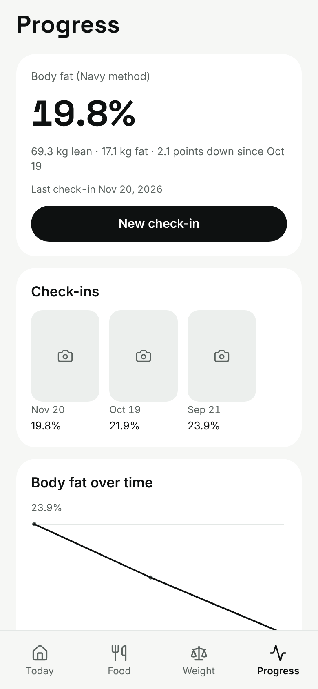
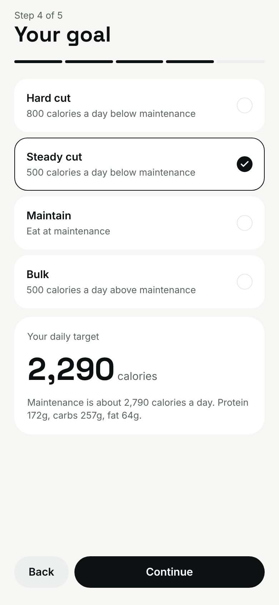

# Calories and Steps

A simple, private Android app for tracking what you eat, how much you move and how your body changes. No account, no ads, no cloud: everything stays on your phone.

<p align="center">
  
  
  
  
</p>

**[Download the latest APK](https://github.com/warwickbuilds/calories-and-steps/releases/latest)** · Android only · Free and open source

## What it does

- **Calories and macros.** A daily calorie target worked out from your body and activity, with a goal of hard cut, steady cut, maintain or bulk. Protein, carbs and fat are shown against their own targets.
- **Meals.** Log breakfast, lunch, dinner and snacks. Quick add calories in seconds, or copy a meal from yesterday.
- **Weight.** A quick weigh-in on the home screen, charts from a week to all time, a smoothed trend line that ignores water swings, change over each period, and a projection of when you'll reach your goal.
- **Bring your weight history with you.** Screenshot the weight list in your old app (Lose It!, MyFitnessPal, a smart-scale app or anything that shows dates and weights), pick the screenshots, and AI reads every entry. You check and fix the list before anything is saved, and duplicates are skipped. Uses your own Google Gemini, OpenAI or Claude key.
- **Body fat.** Body fat (Navy method) check-ins from a tape measure, with lean and fat mass, plain BMI alongside, and front, side and back photos you can line up and compare side by side.
- **Steps.** A daily step target from 5,000 to 25,000 (step sync from Health Connect is coming).
- **Light and dark.** Follows your phone, or pick one.
- **Updates.** The app tells you when a new version is out.

**Coming next:** photograph a meal and describe it out loud for an AI calorie estimate (using your own Google Gemini, OpenAI or Claude key), barcode scanning, reading nutrition labels, step sync from Health Connect, and backup and restore.

## Install

1. On the phone, open the [latest release](https://github.com/warwickbuilds/calories-and-steps/releases/latest) and download `calories-and-steps-<version>.apk`.
2. Open the downloaded file. Android asks whether your browser (or Files app) may install unknown apps. Tap **Settings**, turn on **Allow from this source**, then go back and tap **Install**. You only need to do this once for that browser or app.
3. **Play Protect** may say the app is unrecognised or "unsafe" because it isn't from the Play Store. Tap **More details → Install anyway**. If it offers to scan the app, that's fine too.
4. Open the app and set up your profile.

**Updating**: when Today shows "Version x is available", tap **Download** and open the file. It installs over the old version and keeps your data. Every release is signed with the same key, so this always works. If Android ever says the app "conflicts with an existing package", the APK was signed with a different key; don't uninstall to get around it, because that deletes your data.

## Getting started

1. Pick metric or imperial.
2. Enter your sex, age and height, then your current weight and an optional goal weight.
3. Choose how active you are and your goal (hard cut, steady cut, maintain or bulk). You'll see your daily calorie target and macros straight away.
4. Set a daily step target.

<p align="center"></p>

You can change any of this later in Settings (the gear on the Today screen).

## Your data and privacy

- Everything is stored on your phone. There is no account and nothing is uploaded.
- **Uninstalling the app, or clearing its storage in Android settings, deletes all your data and photos.** Installing a new version over the top keeps it. Backup and restore are on the way.
- The app sends only two things: a daily check with GitHub for a newer version, and, when you import weights from screenshots, those screenshots to the AI provider you chose, using your own key. The app doesn't keep the screenshots.
- When AI meal estimates arrive, the photo and description of a meal go to the AI provider you choose, using your own key. With a free Google Gemini key, Google may use those requests to improve its models, so a paid key is recommended.

---

# For developers

Everything below is about how the app is built, released and maintained.

- MVP plan: https://claude.ai/artifact/KJqryMXn1xGxdkzNyhkXJX
- Design spec ("Rings"): https://claude.ai/artifact/K2jUTsD1PoJ4e57GyVbH9M

Wording rule: the app always says "calories", never "kcal".

## Contents

- [Status](#status)
- [Features](#features)
- [Versions and changelog](#versions-and-changelog)
- [Architecture](#architecture)
- [Services](#services)
- [Releases](#releases)
- [Running it](#running-it)
- [Maintenance](#maintenance)
- [Future enhancements](#future-enhancements)

## Status

| Phase | Scope | State |
| --- | --- | --- |
| 1. Foundation | Onboarding, profile, targets, Today screen, settings, database | Done (PR #1, #2) |
| 2. Weight and body fat | Weight charts, change cards, goal projection, Navy check-ins with photos | Done (PR #3) |
| Weight import | Import weight history from another app's screenshots with AI; provider adapter and API key setup (shared with Phase 3) | Done (PR #7) |
| 3. AI meal logging | Photo and voice meal estimate, review screen, consent screen (adapter and key setup already built) | Next |
| 4. Barcode, panels and steps | Open Food Facts scanner, nutrition-panel reading, favourites, step sync | Planned |
| 5. Backup and polish | Zip export and import with a backup reminder, empty and offline states, icons | Planned |
| Releases | Signed APKs on GitHub Releases, in-app update check, public README | Done (PR #5) |

The app has not yet been installed on a phone. The first signed APK comes from tagging `v0.2.0` once the release key secrets are set up (see [Releases](#releases)).

## Features

The detailed list of what works now.

### Profile and targets

- Onboarding asks for units, sex, age, height, current and goal weight, activity level, goal mode and daily step target.
- Age is stored as the age entered plus the date it was entered, and goes up by one on each anniversary. There is no date of birth.
- Daily calorie target: Mifflin-St Jeor maintenance × activity level, then a flat daily offset for the goal:
  - Hard cut: 800 calories below maintenance
  - Steady cut: 500 below
  - Maintain: 0
  - Bulk: 500 above
- The target never goes below 1,500 calories for men or 1,200 for women. It is recalculated as weight changes.
- Macros: protein 2 g per kg, fat 25% of calories, carbs the rest.
- Step target slider from 5,000 to 25,000 in steps of 500.
- Metric by default, with a switch to lb and inches. Everything is stored in metric.

### Today screen

- Steps and calories rings. Steps shows "Connect steps" until step sync arrives in Phase 4.
- Calories left, or "N over" in red once past the target.
- Protein, carbs and fat bars against their targets.
- Breakfast, Lunch, Dinner and Snacks, each with a "+" button and two pills:
  - "Quick add" enters calories and optional macros.
  - "Same as yesterday" copies yesterday's items for that meal. It is hidden when that meal was empty yesterday.
- "Weight today" card for a quick weigh-in.

### Food tab

- Lists what was logged today, by meal, with delete.

### Weight tab

- Chart with 1W, 1M, 6M, 1Y and All, plus a smoothed trend line (exponential smoothing, 10% per day) so water swings don't dominate.
- Change over the last week, month, 6 months, year and all time.
- Goal projection from the last four weeks of the trend, plus the weekly rate needed for an optional target date.
- Plain BMI and a weight history list.
- "Import from screenshots" button under History (also in Settings → Your data). See [Weight import](#weight-import).

### Weight import

- Pick up to 30 screenshots at a time from the phone's photo picker. Each is shrunk to 1080 px wide and sent, one at a time, to the chosen AI provider, which returns every date and weight it can see as JSON (a fixed schema: year or null, month, day, weight, kg or lb, and whether it came from a list row or a chart).
- Works with any app's list of dated weights, not only Lose It!. Stones and pounds are converted to pounds by the model, then everything is stored in kg.
- Rows without a year get the most recent year that isn't in the future, and are marked "Year not shown, so it was guessed".
- Rows that aren't real dates, are in the future, or are outside 20–400 kg are dropped and counted.
- Overlapping screenshots are merged by date. List rows win over chart estimates; if two readings of the same date disagree, the most common one wins and the other is shown ("Also read as …").
- A screenshot with only a chart gives up to 12 estimated key points, marked "Estimated from the chart". They are ticked only when no list rows were found.
- Review screen: every date with a tick box and an editable weight in your units. Dates already in the app with the same weight (within 0.05 kg) are left alone. Dates with a different weight are unticked and show the app's value; ticking one replaces it.
- "Add more screenshots" keeps what was already read and any ticks or edits. Saving is one transaction. Imported rows are stored at midday local time with source `import`.
- A bad key or a rate limit stops the run early with a plain message; other failures are listed per screenshot.

### AI provider and key

- Settings → AI: choose Gemini (default), OpenAI or Claude, paste a key, **Test key**, and optionally change the model. "Get a key" opens the provider's key page. The Gemini free-tier privacy note is shown under the key field.
- Keys, the provider choice and model overrides are kept in expo-secure-store (Android Keystore), not in the database.

### Progress tab

- "Body fat (Navy method)" check-ins: neck and waist, plus hips for women, giving body-fat %, lean mass and fat mass. Plain BMI is shown alongside.
- Front, side and back photos for each check-in, taken with a framing guide and a faint ghost of the last photo so shots line up.
- Scrollable photo timeline, side-by-side compare of any two dates, and a body-fat chart.

### Settings

- Every profile field, units, goal mode, target date and step target.
- Appearance: System, Light or Dark.
- Your data: a warning that everything lives only on this phone, so uninstalling or clearing storage deletes it, while installing a new version over the top keeps it.
- App version, with a "Check for updates" button.

### Updates

- On Android the app asks GitHub for the latest release at most once a day. When a newer version exists, Today shows a "Version x is available" card with a Download button that opens the APK link. "Not now" hides it until the next version.
- The check sends one anonymous request to `api.github.com` and nothing else. If GitHub can't be reached, or the repo is private, it stays quiet.

## Versions and changelog

App version: **0.3.0** (in `app.json` and `package.json`). Android's `versionCode` is worked out from it in `app.config.js` (major × 10,000 + minor × 100 + patch, so 0.2.0 is 200). Releases are tagged `v<version>`.

| Date | Change | PR |
| --- | --- | --- |
| 2026-11-24 | Import weight history from screenshots of another app, read by AI. Provider-agnostic AI adapter (Gemini, OpenAI, Claude) and API key settings. Version 0.3.0 | #7 |
| 2026-11-24 | Release workflow also attaches the APK to a release made on GitHub's Releases page | #6 |
| 2026-11-23 | Android-only sideloading: signed APK release workflow, release-key signing plugin, versionCode from the version, in-app update check, uninstall warning, install guide. README split into a public part (features, screenshots, install) and a developer part. Version 0.2.0 | #5 |
| 2026-11-23 | README brought fully up to date; rule added to keep it current with every PR | #4 |
| 2026-11-23 | Phase 2: weight charts, goal projection, Navy body-fat check-ins with photos | #3 |
| 2026-11-23 | Ask for age instead of date of birth (migrations 0001 and 0002) | #2 |
| 2026-11-23 | Phase 1: foundation, onboarding, settings, Today screen; meal pills; Appearance switch | #1 |

### Main dependency versions

| Package | Version |
| --- | --- |
| Expo SDK | 58 (`expo ~58.0.26`) |
| React Native | 0.88.1 |
| React | 19.3.0 |
| Expo Router | ~58.0.32 |
| expo-sqlite | ~58.0.18 |
| Drizzle ORM / drizzle-kit | ^0.45.4 / ^0.31.11 |
| Reanimated | 4.7.1 |
| react-native-svg | ^15.16.0 |
| expo-camera / expo-image-manipulator / expo-file-system | ~58.0.14 / ~58.0.16 / ~58.0.14 |
| expo-constants (update check) | ~58.0.16 |
| expo-image-picker (weight import) | ~58.0.10 |
| expo-secure-store (AI keys) | ~58.0.3 |
| Release build tools (CI) | Node 22, JDK 17 (Temurin), Gradle from the Expo template |
| TypeScript | ~6.0.3 |
| Jest (jest-expo preset) | ^30.5.2 |

## Architecture

```
Screens (src/app, Expo Router)
   │  read through live hooks (src/hooks/data.ts → Drizzle useLiveQuery)
   │  write through small functions (src/db/queries.ts, meals.ts, body.ts)
   ▼
SQLite on the phone (expo-sqlite + Drizzle, schema in src/db/schema.ts)
   +  photo files in the app's document folder (paths stored in the DB)

Pure maths and formatting (src/lib) is shared by screens and tested on its own.
```

- **App framework**: Expo with TypeScript, run as a development build (not Expo Go) because of native modules. Routes live in `src/app`.
  - Tabs: Today, Food, Weight, Progress.
  - Stack screens: settings, quick-add (modal), check-in (modal), camera (full screen), check-ins/[id], compare, import-weights.
  - `Stack.Protected` shows onboarding until a profile exists.
- **Data**: one SQLite file, 8 tables: profile, meal, food_item, food_ref, weight_entry, body_check, body_photo, steps_day. All values are metric; display converts.
  - Live queries need `enableChangeListener` (set in `src/db/client.ts`), and foreign keys are switched on.
  - Migrations in `drizzle/` are bundled into the app (babel inline-import plus a metro `sql` extension) and run at start-up by `useMigrations` in `src/app/_layout.tsx`.
- **Photos**: taken with expo-camera, saved by expo-image-manipulator as a 1080 px JPEG plus a 240 px thumbnail under `document/photos`. The database stores relative paths only, so backups and restores stay portable. `src/lib/captureStore.ts` hands camera results back to the check-in screen.
- **AI** (`src/lib/ai/`): one adapter for every AI feature. A feature describes its request once (prompt, images, JSON Schema) as an `AiJsonRequest`; `providers.ts` turns it into a Gemini `generateContent`, OpenAI Responses or Claude Messages call with structured JSON output and low reasoning effort, and parses the answer. Calls use `fetch` straight from the phone, no SDKs. `settings.ts` stores the provider, keys and model overrides in secure store. `weightScreenshot.ts` holds the screenshot prompt and schema; `prepareImage.ts` shrinks images to base64 JPEG. Phase 3's meal estimate will add its own prompt and schema on the same adapter.
- **Weight import** (`src/app/import-weights.tsx`, `src/lib/weightImport.ts`): the pure functions check each row, merge screenshots and compare with existing weights; `importWeights` in `src/db/queries.ts` saves the ticked rows. `weight_entry.source` gained the value `import` (a TypeScript enum only, so no migration).
- **Charts**: a small custom SVG line chart (`src/components/LineChart.tsx`) instead of a chart library. Charts use neutral colours, because green and orange are reserved for steps and calories.
- **Release build** (`app.config.js`, `plugins/`): `app.config.js` adds the `versionCode` and the `withReleaseSigning` config plugin on top of `app.json`. The plugin edits the generated `android/app/build.gradle` so release builds sign with the key named by `ANDROID_KEYSTORE_PATH` and friends, falling back to the debug key when they are not set. `android/` itself is never committed; `expo prebuild` regenerates it.
- **Update check** (`src/lib/updates.ts`, `src/lib/version.ts`, `src/components/UpdateBanner.tsx`): compares the installed version (`expo-constants`) with the latest GitHub release of `extra.releasesRepo` in `app.json`, caching the result and any dismissed version in `update-check.json` in the document folder.
- **Design system**: tokens in `src/theme` (colours for light and dark, spacing, radius, type scale). Space Grotesk for numbers and headings, Inter for text, lucide icons. Font scaling is capped at 1.3×.
- **Maths** (`src/lib`): `energy.ts` (maintenance, targets, age), `body.ts` (Navy formula, BMI), `weight.ts` (trend, change rows, projection), `units.ts`, `dates.ts`, `today.ts`, `validation.ts`.

### Folder layout

```
src/app/          Screens (Expo Router). (tabs)/ holds Today, Food, Weight and Progress.
src/components/   UI kit (ui/), profile input fields (fields/), chart, photo thumb, shared cards
src/db/           SQLite schema, client, queries and write functions
src/hooks/        Live data hooks
src/lib/          Pure maths and formatting, with tests in __tests__/
src/lib/ai/       AI provider adapter, key settings and prompts
src/theme/        Design tokens (colors.ts, tokens.ts) and the theme provider
drizzle/          Generated migrations, bundled into the app
plugins/          Expo config plugins and helpers for the Android release build
docs/screenshots/ README screenshots
.github/workflows Android release workflow (android-release.yml)
```

## Services

| Service | Used for | State |
| --- | --- | --- |
| GitHub | Code and pull requests | In use |
| GitHub Actions | Builds, signs and publishes the release APK on every `v*` tag (`android-release.yml`). Holds the release key as secrets. Free for this use | In use |
| GitHub Releases | Hosts the APKs. The app reads `api.github.com/repos/<repo>/releases/latest` once a day to offer updates. Needs a public repo (see [Releases](#releases)) | In use |
| Expo EAS Build | Optional development builds for working on the app. Not used for releases, so the free tier's monthly build limit doesn't matter | Optional |
| Apple App Store and Google Play | Store release | On hold |
| Google Gemini (default), OpenAI, Anthropic Claude | Reading weight screenshots (now), and AI meal and nutrition-panel estimates (Phase 3), using the user's own API key stored in the Android Keystore (expo-secure-store). Default models: `gemini-3.6-flash`, `gpt-6-luna`, `claude-haiku-5-5`, changeable in Settings. Rick uses a paid Gemini key. On Google's free tier, Google may use requests (screenshots, photos and descriptions) to improve its models, so Settings says so and recommends a paid key | In use (weight import) |
| Open Food Facts | Barcode lookups. Free, no key, results cached locally | Phase 4 |
| Apple Health (HealthKit) and Health Connect | Reading daily steps, and weight from smart scales. Google Fit is skipped because it is being retired | Phase 4 |

The only network calls today are the daily update check and, when the user imports weights, the screenshots sent to their AI provider. Once AI and barcodes arrive, the only calls will be the AI estimate, the Open Food Facts lookup and an optional backup the user chooses to save. Voice notes will be transcribed on the phone and never uploaded.

## Releases

APKs are built and signed by GitHub Actions (`.github/workflows/android-release.yml`) with a local Gradle build (`expo prebuild` then `gradlew assembleRelease`), not EAS.

### One-time setup: the release key

Android only installs an update if it is signed with the same key as the installed app. **If the key is lost, no update can ever install over the existing app again**, and the only way forward is uninstalling, which wipes the data. So make it once, keep two backups, and never commit it.

1. Make the key on your computer (needs a JDK; Android Studio includes one, or install Temurin 17). Pick a strong password when it asks:

   ```bash
   keytool -genkeypair -v -storetype PKCS12 -keystore calories-and-steps-release.jks \
     -alias calories-and-steps -keyalg RSA -keysize 4096 -validity 36500 \
     -dname "CN=Calories and Steps"
   ```

2. Back it up: save the `.jks` file and the password in your password manager, and a second copy somewhere offline (for example a USB stick). Don't put it in the repo folder.
3. Encode it for GitHub:
   - macOS / Linux: `base64 -i calories-and-steps-release.jks | tr -d '\n' > keystore.txt`
   - Windows PowerShell: `[Convert]::ToBase64String([IO.File]::ReadAllBytes("calories-and-steps-release.jks")) | Set-Content keystore.txt`
4. Get the certificate fingerprint: `keytool -list -v -keystore calories-and-steps-release.jks -alias calories-and-steps` and copy the `SHA256:` line.
5. In GitHub, open the repo's **Settings → Secrets and variables → Actions → New repository secret** and add:

   | Secret | Value |
   | --- | --- |
   | `ANDROID_KEYSTORE_BASE64` | Contents of `keystore.txt` |
   | `ANDROID_KEYSTORE_PASSWORD` | The password |
   | `ANDROID_KEY_ALIAS` | `calories-and-steps` |
   | `ANDROID_KEY_PASSWORD` | The password (same as above) |
   | `ANDROID_CERT_SHA256` | The SHA256 fingerprint (optional, but the build then refuses to publish an APK signed with any other key) |

6. Delete `keystore.txt`.
7. The repo must be public (**Settings → General → Danger Zone → Change visibility**) so the APK links and the in-app update check work without signing in. Nothing private is in the code or its history.

### Making a release

1. In a PR, bump `version` in `app.json` and `package.json` (for example 0.2.0 → 0.3.0) and add a changelog row.
2. After it merges, either push a tag (`git tag v0.3.0 origin/main && git push origin v0.3.0`), or on GitHub open **Releases → Draft a new release**, type `v0.3.0` as a new tag on `main`, and publish. In the second case the release appears straight away and the APK is added to it when the build finishes.
3. The workflow checks the tag matches `app.json`, runs the tests, builds and signs the APK, checks the signature and publishes the release with the APK attached. It takes about 15 to 25 minutes.

Pull requests that change the build set-up (`app.json`, `app.config.js`, `plugins/`, dependencies or the workflow) also build the APK, without releasing it, and keep it as a build artifact for 7 days. **Run workflow** on the Actions tab does the same for any branch.

## Running it

For day-to-day development the app runs in a development build rather than Expo Go, because it uses native modules.

```bash
npm install
npx eas-cli@latest login
npx eas-cli@latest build --profile development --platform android   # or ios
npx expo start --dev-client
```

Install the build from the link EAS gives you, then open it while `expo start` is running. A new development build is needed whenever a native module is added (Phase 2 added the camera).

### Scripts

| Command | What it does |
| --- | --- |
| `npm test` | Unit tests for the calorie, unit, body-fat, weight-trend and Today maths, the weight-import merging and the AI request builders |
| `npm run typecheck` | TypeScript check |
| `npm run lint` | ESLint |
| `npm run db:generate` | Generate a migration after changing `src/db/schema.ts` |
| `npx expo export -p android` | Bundles the app, a quick check that everything resolves. (The web bundle fails on expo-sqlite's wasm file; the app doesn't target web) |

## Maintenance

- **Before every PR**: run `npm test`, `npm run typecheck`, `npm run lint` and `npx expo export -p android`, and update this README (see `CLAUDE.md`).
- **Adding a package**: use `npx expo install <package>` so it matches the SDK. If that can't reach Expo's servers, read the right version from `node -e 'console.log(require("expo/bundledNativeModules.json")["<package>"])'` and `npm install` it.
- **Native modules**: after adding one, add its config plugin to `app.json` if it has one, then make a new EAS development build.
- **Database changes**: edit `src/db/schema.ts`, run `npm run db:generate`, and check the SQL it writes into `drizzle/`. drizzle-kit asks about renames interactively and fails when it can't, so do a rename as two migrations (add the new column, then drop the old one) and hand-add any data backfill. Never edit a migration that has shipped.
- **Upgrading the Expo SDK**: read the SDK release notes, run `npx expo install expo@^<new>` then `npx expo install --fix`, run all the checks, then make new development builds.
- **Releases**: see [Releases](#releases). Never reuse or lower a version: Android needs a higher `versionCode` every time. Minor and patch must stay below 100.
- **Screenshots** (`docs/screenshots`): taken from the web build at 390×844, 2× scale, with Playwright. `metro.config.js` adds `wasm` as an asset so expo-sqlite's web worker bundles. On web the database must be opened with `openDatabaseAsync` once before the app loads, so use a temporary entry file that does that (and seeds sample weights and check-ins) and points `main` at it while capturing. Don't commit that entry. Retake them when a screen changes noticeably.
- **Release key**: lives only in GitHub secrets and Rick's backups. If GitHub secrets are ever lost, re-add them from the backup. If the key itself is lost, a new key means every phone has to uninstall (and lose data) once, so take a backup export first.
- **Build tools**: the workflow uses Node 22 and JDK 17. When an Expo SDK upgrade needs newer ones, change them in `android-release.yml`.
- **AI models**: providers retire model names. When one stops working (Settings → Test key says the model isn't recognised), update `defaultModel` in `src/lib/ai/providers.ts`; users can also type another model under **Change model**. Gemini's `generateContent` is now a legacy API (still supported); move to its Interactions API if Google announces a shutdown.
- **expo-image-picker** is used without its config plugin on purpose: the plugin's `cameraPermission: false` would block the camera permission the progress photos need, and leaving it out keeps the microphone permission off. Android's photo picker needs no permission. Add the plugin (with `photosPermission`) when iOS returns.
- **Design rules**: green is only for steps and orange only for calories. Say "calories", never "kcal".

## Future enhancements

Everything we've discussed that is not built yet.

**Phase 3: AI meal logging**
- Photo plus hold-to-talk voice note, transcribed on the phone, sent in one request to the user's chosen AI provider.
- Meal and nutrition-panel prompts and schemas on the existing provider adapter. Mid-tier models for meals, the cheapest model for nutrition panels, low reasoning effort.
- Review and edit screen (edit grams, delete, add items) before saving.
- A guided "get your key" step in onboarding (the key card with a test button already exists in Settings), and a one-time consent screen naming the provider and what is sent.
- Gemini privacy note on the consent screen: with a free-tier key, Google may use the photos and descriptions sent to improve its models (and people may review them); a paid key (billing turned on) avoids this, so the note recommends one.
- A weighed 30-meal benchmark across providers to pick the default models.
- Food log tab with day-by-day history, swiping between days and a weekly calorie average.

**Weight import, later**
- Import a CSV file for apps that do export, and weight history from Health Connect.
- Read very long scrolling screenshots in slices, and more than 30 screenshots in one go.
- Mark imported entries in the weight history list, with an "undo this import" option.

**Phase 4: barcode, panels and steps**
- Open Food Facts barcode scanner with a servings picker. Unknown products fall back to photographing the nutrition panel.
- Favourites and recent foods.
- Step sync from Apple Health and Health Connect, with a history chart and the step target as a goal line.
- Optional weight sync from smart scales through the health app.

**Phase 5: backup and polish**
- Export a single zip (database, manifest and photos) through the share sheet, and import it back.
- A reminder to back up every couple of weeks, showing the date of the last backup, plus a nudge to export before installing an update by hand.
- Empty states, offline error handling, app icons.

**After the MVP**
- Optional Play Store (or internal testing track) release, and a return to iOS with App Store and TestFlight. The iOS settings in `app.json` and the EAS profiles are kept for this.
- Download and open the update APK from inside the app instead of through the browser.
- A small key-holding relay (with App Attest and Play Integrity) so people can use the AI without their own key.
- Signing in with OpenRouter instead of pasting a key.
- Automatic Google Drive backup.
- Home-screen widgets.
- Adding active calories burned to the daily calorie budget.
